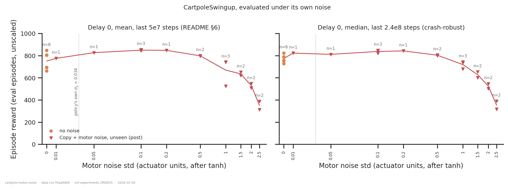
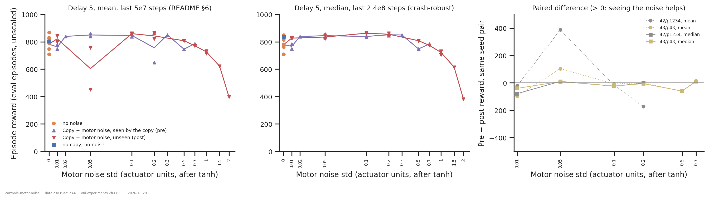
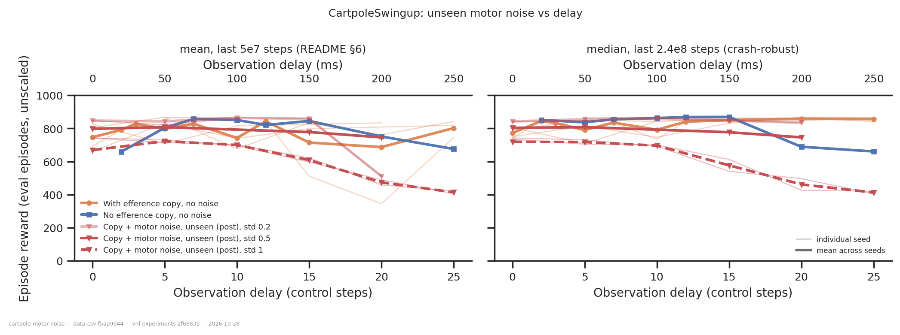
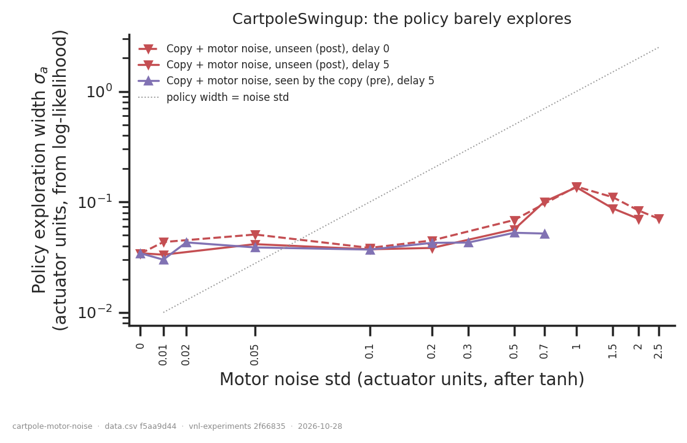
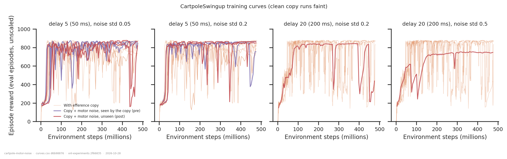
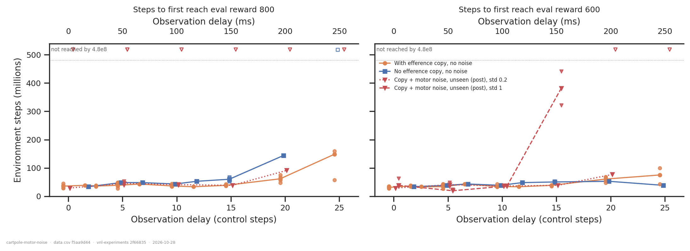

# Motor noise and the efference copy on CartpoleSwingup

> **For the record; ambiguous by construction.** These are 103 usable runs, most noisy cells
> have 1–2 seed pairs, and **no noisy no-copy arm exists**. CartpoleSwingup turned out to
> be a poor test bed for this question: delay barely costs it anything, and its training
> curves crash and recover constantly. The WalkerWalk counterpart is
> [`../walker-motor-noise/`](../walker-motor-noise/report.md), and both folders were split
> from `motor-noise-first-look` on 2026-10-28.

## Question

This is the same question as the WalkerWalk folder. Fixed Gaussian noise on the executed
action, either **seen** by the efference queue (`pre_efference`) or **unseen**
(`post_efference`), should make the copy useful on a deterministic task, but only when the
queue sees the noise. Here only the pre-vs-post contrast can be drawn, and only at delay 5.
Post alone was run at delays 0, 10, 15, 20 and 25. The 2026-10-28 batch adds a post
sweep at std 1.0 over d5–d25 (2 seed pairs each).

## Answers up front

| | answer |
|---|---|
| **What does noise cost on its own?** | Nothing up to std 0.5, then a smooth decline: the delay-0 median is 803 at 0.5, 719 at 1.0, 627 at 1.5, 525 at 2.0 and 353 at 2.5 (fig. 1). The policy's own exploration width is σₐ ≈ 0.034, so the cliff starts at about 30× that. |
| **Small noise *helps*** | Std 0.1 beats the noise-free run of the same seed pair in all **4 of 4** pairs (d0 and d5, i42 and i43), by **+39 to +149** on the median. The policy is nearly deterministic (σₐ ≈ 0.035 against `min_std` 0.001), and noise of a few times that seems to act as a regulariser. |
| **Seen vs unseen (d5)** | **No difference.** On the crash-robust median, pre − post is between −79 and +11 in all 10 paired comparisons, and within ±25 in 7 of them (fig. 2). The large swings in the README window mean (−173 to +388) are crash timing. |
| **Delay** | Barely matters out to d15 for the clean arms and for std ≤ 0.5. Every such arm has a median of 740–870. A first hint of a copy advantage appears at d20–25: clean no-copy is at 689 / 661 against copy at 846–867, and clean no-copy is also slower to reach 800 (144M against 47–75M at d20, never at d25). That is one no-copy seed pair, so it remains a hint. |
| **Delay × noise (new, std 1.0)** | **At std 1.0 delay does amplify the noise cost.** The unseen-noise median is 719 at d0, 718 at d5, 696 at d10, 577 at d15, 462 at d20 and 413 at d25 (2 seed pairs per delay, within 75 of each other). From d15 on these runs also take 3–4e8 steps to first reach 600 and never get there at d20–25 (fig. 6). This is the first delay-dependent noise effect on this task. Without a pre or noisy no-copy arm at std 1.0, it cannot be attributed to the copy. |
| **Verdict** | At std ≤ 0.5 CartpoleSwingup cannot test the hypothesis: the copy has nothing to do, with or without noise. **Std 1.0 at d15–25** is the first regime where noise and delay interact, so that is where to run pre / post / noisy no-copy if this task is revisited. |

## Dataset & comparability

- **Source:** `emiwar-team/nnx-ppo-delays`, index synced 2026-10-28. There are **106
  CartpoleSwingup runs** in [`runs.csv`](runs.csv). 103 have a readout; three failed at
  step 0 (`y2bctbw8`, `uqmzersa`, `maed1uj1`), and each has a finished sibling with the same
  config.

  | arm | runs with a readout |
  |---|---|
  | post | 49, at std 0.01–2.5, delays 0/5/10/15/20/25 |
  | pre | 12, at std 0.01–0.7, delay 5 only |
  | clean copy | 33, delays 0–25 |
  | clean no-copy | 9, all seed pair i42/p1234 |
  | noisy no-copy | **0** |

- **Gates:** the same as the WalkerWalk folder (`DelayedMLP`, privileged critic, `min_std`
  0.001, torque, no distillation, post-`d168093`). Every run has a 4.8e8 budget.
- **Programmatic comparability** ([`comparability.txt`](comparability.txt)): all 22
  invariants are single-valued within every condition. History coverage is 106/106 for both
  specs ([`coverage.txt`](coverage.txt)).
- **Working copy:** most runs (most post, 12/12 pre, 25/33 clean copy, 9/9 clean
  no-copy) had a dirty `vnl-experiments` working copy.

### Two readouts, because the curves crash

CartpoleSwingup's eval reward drops to about 200 and recovers within a few eval points
throughout training, and that includes the noise-free runs (fig. 5). The README §6 readout,
the mean over the last 5e7 steps (≈ 10 eval points), therefore mostly measures whether a
crash happened to fall in that window. For example:
- at d20 the four clean copy runs read 345–834 on the window mean, but **846–867 on the
  median**;
- the post 0.05 i42 run at d5 reads 451 on the mean and 822 on the median.

So `extract.py` adds two columns:
- **`reward_median`**: the median over the last 2.4e8 steps (≈ 48 eval points), which is
  what the policy does when it isn't crashing;
- **`dip_frac`**: the fraction of those points below 600, which is how often it crashes.

Every reward figure shows both readouts side by side. **The answers above use the median.**
`dip_frac` shows no consistent dependence on noise up to std 0.5 (0–0.14 for all arms at
d≤15). From 1.5 on, the policy is simply worse, and the dip fraction reaches 1.0 at std 2.

- **Run-to-run floor:** same config and seed pair on different GPUs:
  - window mean: 4–79 apart (the d5 i43 clean triple spans 748 / 790 / 827);
  - the A100 d5 i42 pair is bit-identical, which is also the check that the noise site is
    inert at std 0.
  - Treat single-run differences below ~80 on the mean, or ~30 on the median, as
    unresolved.

## Figures

All reward axes span 0–1000. The left panel shows the window mean and the right panel the
median.

**Figure 1: the noise scale at delay 0.**
- The clean runs (orange) are spread over 727–822 on the median.
- Std 0.01–0.2 sits at the top of that range or above it.
- Reward falls smoothly from std 0.5 on. Unlike WalkerWalk (a cliff between 0.7 and 1.0),
  there is no sharp threshold.

**Figure 2: seen vs unseen at delay 5.**
- On the mean (left), the two sites look different at 0.05 and 0.2, but those are single
  crashes.
- On the median (middle), the pre and post lines are indistinguishable at every std.
- Right: the paired pre − post, with the dotted line the mean and the solid line the
  median. The median differences hug zero.

**Figure 3: delay.**
- On the median, every arm is flat at about 850 out to d15.
- Post 0.5 sits about 50–100 lower at every delay. That is the noise's own cost, and it does
  not grow with delay (807 at d5, 777 at d15, 746 at d20).
- **Post 1.0 (dashed, 2 seed pairs) does fall with delay**: flat at about 700–720 to d10,
  then 577 at d15, 462 at d20 and 413 at d25. Below std 1 the noise cost is
  delay-independent; at 1 it is not.
- The clean no-copy line drops at d20–25. That is one seed pair; clean copy holds at about
  860.

**Figure 4: the policy's own exploration width against the noise std.**
- σₐ stays at about 0.035–0.05 until the noise std reaches about 0.5, then rises to 0.13 at
  std 1.0 and falls again.
- Every tested std above 0.05 is well above the dotted σₐ = std line. So on this task the
  noise was never "too small" by the WalkerWalk yardstick. The copy just has nothing to do
  with it.

**Figure 5: why the window mean is unreliable.**
- Clean copy runs (faint) crash repeatedly at d5 and d20.
- At d5 the noisy runs crash about as often.
- The single d20 post 0.5 run is the smoothest curve in the set: no crash after ~3e8 steps,
  but a lower plateau (~750). Whether noise stabilises training is a side question that one
  run can't answer.

**Figure 6: time to solve.** Every run has the same 4.8e8 horizon.
- **Reaching 800** (left):
  - Clean copy gets there in ~30–50M steps out to d15, and slows only at d20–25 (47–75M
    and 58–160M).
  - The single clean no-copy seed is slower at d20 (144M) and never gets there at d25.
  - Post 1.0 never reaches 800 at any delay, which is its noise cost.
- **Reaching 600** (right): post 1.0 matches the clean arms to d10, needs 3.2–4.4e8 at d15,
  and never gets there at d20–25. That is where noise and delay start to compound.

## Interpretation (hedged)

- **Null for the hypothesis, but an uninformative null.** The hypothesis predicts a pre >
  post gap only where in-flight actions matter, that is, where delay hurts. On
  CartpoleSwingup the delay costs nothing out to d15 (and ~10 ms control steps make d15 only
  150 ms). There is no gap to widen, and none appears.
- **Std 1.0 is the exception.** Its cost grows with delay from d15 on, in both reward and
  learning speed. That is the regime where in-flight actions could start to matter. It is
  also where the hypothesis makes a testable prediction (pre > post ≈ no-copy), but only
  the post arm has been run there.
- **Small noise helping looks real** (4 of 4 pairs, with gains larger than the run-to-run
  floor). It fits a policy whose exploration has collapsed to σₐ ≈ 0.035: added action noise
  keeps it on more robust swing-up trajectories. It is not specific to the copy, because pre
  and post at d5 help equally.
- **WalkerWalk is the task to pursue.** There the delay bites from d5 on, noise has a
  sharp threshold, and the post ≈ no-copy and pre > post signatures are visible.

## If CartpoleSwingup is revisited

1. Add a **noisy no-copy arm** (`efference=0`), without which no copy advantage can be
   computed.
2. Run **std 1.0 at d15–25** with **pre** and **noisy no-copy** next to the existing post
   runs, with ≥ 3 seed pairs. This is the only regime where noise interacts with delay
   here. Std 0.5 does not interact with delay on this task.
3. Add clean no-copy seeds at **d20–25**, the only delays where the clean copy might
   matter (one seed pair so far).
4. Keep the median readout. A longer eval-free stretch, or more eval episodes, would not fix
   crashes that happen during training.
