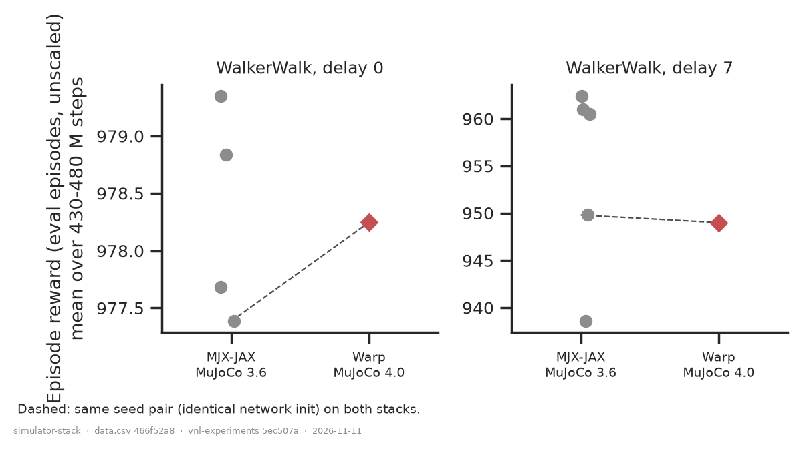

# Does the 2026-11-09 environment update change what dm_control runs learn?

## Question

The 2026-11-09 cluster venv rebuild changed MuJoCo 3.6.0 → 4.0.0 *and* — silently, via
playground 0.1.0 → 0.2.0 flipping the dm_control default `impl` — the physics backend
from MJX-JAX to MuJoCo Warp. Do runs after the update reach the same reward as the same
configuration before it, and how much faster do they train? "Same" here means: a
post-update run falls inside the pre-update seed-to-seed spread for that configuration,
and is close to the pre-update run that shares its seed pair (and hence its network
initialisation). This is a before/after comparison of the update as a whole; the
version and backend changes are not separated.

## Dataset & comparability

- **Source:** WandB `emiwar-team/nnx-ppo-delays`, selected by `CONDITIONS` in
  `extract.py` and frozen in `runs.csv` (298 runs). Selection is anchored on the finished
  post-update runs: every run whose full, schema-normalised config equals an anchor's
  (reward cohort, seeds free), or equals it up to delay / efference / motor noise /
  critic (speed cohort).
- **Conditions** (label inferred from `env_params.impl` + `nconmax`/`naconmax`, and
  verified per run against WandB's `requirements.txt` → `stack_versions.csv`):

| condition | stack | reward cohort | speed cohort |
|---|---|---|---|
| `mjx_jax_mujoco36` (before) | MJX-JAX, mujoco 3.6.0, warp-lang 1.12.0, jax 0.10.1, playground 0.1.0 | 9 runs: WalkerWalk d0 (4 seed pairs), d7 (5) | 296 runs, 8 GPU models |
| `warp_mujoco40` (after) | Warp, mujoco 4.0.0, warp-lang 1.19.0, jax 0.12.0.1, playground 0.2.0 | WalkerWalk d0 and d7, both i42/p1234 | 2 runs (H200, A40) |

  All WalkerWalk, DelayedMLP, noise-free, privileged critic, `train=dmc`,
  `reward_scale = 10`.
- **Reward reported:** `eval/episode_reward/mean` (eval episodes, unscaled, bare eval env),
  mean over the (430 M, 480 M] window. Every run descends from the eval-wrapper fix
  `971ab99` (asserted in `extract.py`), and every reward-cohort run has lifespan 1000 in
  the window (asserted). Runs trained to 1 G are read at 480 M.
- **Tasks:** WalkerWalk only. The terrain runs since 2026-11-09 are a new task with no
  pre-update counterpart.
- **Artifacts used:** `history:hist2000-8b97281e`, `timing:timing20000-3089bf7d` —
  full coverage for both (`coverage.txt`).
- **Programmatic comparability** (`comparability.txt`): within a reward cell every config
  field is equal by construction. Flagged as varying: `env_params.impl` (part of the
  manipulation), `git_commit`, `repos.nnx_ppo.commit` and `repos.vnl_experiments.dirty` —
  see the manual check.
- **Manual comparability:**
  - *Task code.* Diffed playground 0.1.0 vs 0.2.0 `dm_control_suite`: `walker.py` differs
    **only** in the `impl` default and the `nconmax`→`naconmax` rename; XMLs identical.
    Rewards and observations are unchanged.
  - *vnl-experiments* `971ab99` → `7b03e9a`/`5ec507a`: `conf/train/dmc.yaml` and
    `conf/env/dmc/walker_walk.yaml` change only the eval/video cadence, video camera and
    run-name template; the code diffs (registry, train.py, network builders) add servo,
    motor noise, the critic option, the NaN guard, distillation and requeue, each a no-op
    at the values these runs use (`servo_kp = 0`, noise 0, `privileged_critic = True` =
    the pre-`a37ce64` behaviour). `5ec507a` → `7b03e9a` is the one-line wandb-id fix.
    Benign by reading, not by hash. Several runs have `vnl_experiments.dirty = True`, so
    their commit does not fully identify the code; the configs, which were logged, match.
  - *nnx-ppo* `1725d20` → `5314279` → `21d6643`: `ppo.py` gains NaN/diagnostic metrics and
    the distillation path; the update itself is unchanged.
  - Tags and notes read: both post-update runs are "Trying MuJoCo 4.0" (the d7 one "with
    requeue").
- **Caveats:**
  - MuJoCo version and backend change together; this cannot say which one any effect
    belongs to.
  - One post-update run per cell, and one post-update run per GPU model for speed;
    node-to-node spread within a model is a few percent.

## Figures

The post-update curve lies on its same-seed pre-update twin at d0, and at d7 tracks it
closely for the first ~150 M steps before the two drift apart and re-converge — the
signature of identical initialisation with chaotically diverging rollouts.

Readout per run; dashed lines join same-seed pairs. d0: 978.2 (after) vs 977.4 (twin),
other pre-update seeds 977.7–979.3. d7: 949.0 vs 949.8 (twin), other pre-update seeds
938.6–962.4.

Median per-iteration gauges, within one GPU model only:

| GPU | before: train / eval k steps/s | after: train / eval | ratio |
|---|---|---|---|
| H200 (n = 48 vs 1) | 359 / 54.0 | 403 / 62.9 | 1.12 / 1.17 |
| A40 (n = 28 vs 1) | 179 / 42.0 | 232 / 65.6 | 1.30 / 1.56 |

## Tentative conclusion

- **No detectable effect of the update on what is learned.** Both post-update runs land
  within ~1 reward of their same-seed pre-update twins and inside the pre-update seed
  spread (z = −0.4 and −0.6). At d7 the twin difference (−0.8) is far smaller than the
  seed spread (sd 11.4). With one run per cell this rules out a large effect, not a
  small one.
- **Training is faster, by less than one might hope.** +12 % (H200) to +30 % (A40) in
  training throughput, and +17 % to +56 % on eval rollouts, which are mostly physics. The
  H200 eval gain is within the pre-update run-to-run range (max 63.8 k); the A40 gains
  and the H200 training gain are outside it.

## Follow-ups

- Relaunch the failed d5 / d10 post-update reruns (`nzrm7s4h`, `qz3x6kci`); their
  pre-update twins `ln7wa5w0`, `eldxqhi6` are in the index, and `--refresh` picks them up.
  A second seed pair per cell would turn "within one seed's spread" into a test.
- A contact-richer task (e.g. HumanoidWalk) after the update, against its pre-update
  runs, before trusting the conclusion beyond WalkerWalk.
- Set `impl` explicitly in `conf/env/dmc/*.yaml` so the backend is a decision, not a
  playground default.

---

*Reproduce:* `../.venv/bin/python analysis/dm_control_suite/simulator-stack/extract.py && ../.venv/bin/python analysis/dm_control_suite/simulator-stack/plot.py`
(add `--sync --refresh` to the extract to pull in reruns added since `runs.csv` was
frozen; refresh also fetches `requirements.txt` for new runs, so it needs WandB auth).
