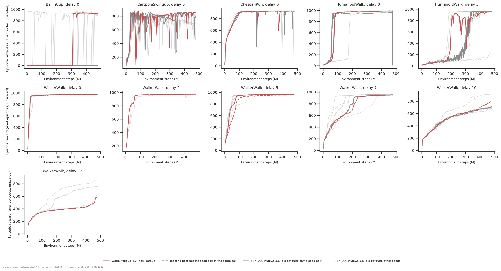
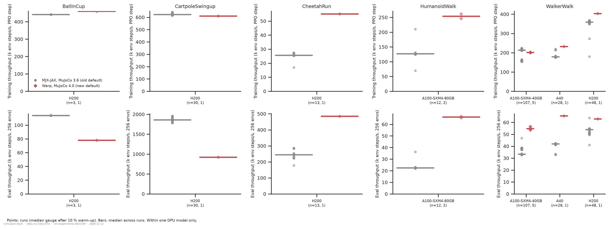

# Does the 2026-11-09 environment update change what dm_control runs learn?

## Question

The 2026-11-09 cluster venv rebuild changed MuJoCo 3.6.0 → 4.0.0 *and* — silently, via
playground 0.1.0 → 0.2.0 flipping the dm_control default `impl` — the physics backend
from MJX-JAX to MuJoCo Warp. Do runs after the update reach the same reward as the same
configuration before it, and how much faster do they train? "Same" here means: a
post-update run falls inside the pre-update seed-to-seed spread for that configuration,
and is no further from the pre-update run that shares its seed pair (and hence its network
initialisation) than two pre-update reruns of one seed pair are from each other. This is a
before/after comparison of the update as a whole; the version and backend changes are not
separated.

## Dataset & comparability

- **Source:** WandB `emiwar-team/nnx-ppo-delays`, selected by `CONDITIONS` in
  `extract.py` and frozen in `runs.csv` (545 runs). Selection is anchored on the finished
  post-update runs: every run whose full, schema-normalised config equals an anchor's
  (reward cohort, seeds free), or equals it up to delay / efference / motor noise /
  critic (speed cohort). Runs not descended from the eval-wrapper fix `971ab99` are
  excluded at selection (6 CartpoleSwingup runs on the pre-fix branch commit `d168093`).
- **Conditions** (label inferred from `env_params.impl` + `nconmax`/`naconmax`, and
  verified per run against WandB's `requirements.txt` → `stack_versions.csv`):

| condition | stack | reward cohort | speed cohort |
|---|---|---|---|
| `mjx_jax_mujoco36` (before) | MJX-JAX, mujoco 3.6.0, warp-lang 1.12.0, jax 0.10.1, playground 0.1.0 | 43 runs | 533 runs, 8 GPU models |
| `warp_mujoco40` (after) | Warp, mujoco 4.0.0, warp-lang 1.19.0, jax 0.12.0.1, playground 0.2.0 | 12 runs | the same 12 |

  Reward cells (pre / post runs): WalkerWalk d0 (4/1), d2 (2/1), d5 (4/2), d7 (5/1),
  d10 (4/1), d12 (3/1); HumanoidWalk d0 (3/1), d5 (5/1); CheetahRun d0 (3/1); BallInCup
  d0 (4/1); CartpoleSwingup d0 (6/1). Post-update runs are seed pair i42/p1234 except
  the two WalkerWalk d5 runs (i43/p43, i44/p44), which have no pre-update same-seed run.
  All DelayedMLP, noise-free, privileged critic, `train=dmc`, `reward_scale = 10`.
- **Reward reported:** `eval/episode_reward/mean` (eval episodes, unscaled, bare eval env),
  mean over the (430 M, 480 M] window. Every run descends from `971ab99` (asserted), and
  every reward-cohort run has lifespan 1000 in the window (asserted). Runs trained to 1 G
  are read at 480 M.
- **Tasks:** the five above. The terrain runs since 2026-11-09 are a new task with no
  pre-update counterpart and are excluded.
- **Artifacts used:** `history:hist2000-8b97281e`, `timing:timing20000-3089bf7d` —
  full coverage for both (`coverage.txt`).
- **Programmatic comparability** (`comparability.txt`): within a reward cell every config
  field is equal by construction. Flagged as varying across the cohort: `env`,
  `ctrl_dt`/`sim_dt` (per task), `env_params.impl` (the manipulation), `git_commit`,
  `repos.nnx_ppo.commit` and `repos.vnl_experiments.dirty` — see the manual check.
- **Manual comparability:**
  - *Task code.* Diffed playground 0.1.0 vs 0.2.0 `dm_control_suite`: `walker.py`,
    `cheetah.py`, `humanoid.py` and `ball_in_cup.py` differ **only** in the `impl`
    default and the `nconmax`→`naconmax` rename; XMLs identical. `cartpole.py`
    additionally rewrites the *vision* path (renderer, vision reward, vision
    termination); the state-based path these runs use (`vision = False` in every run,
    checked at selection) has the same reward, observation and termination. The renamed
    `vision_config.*` keys are therefore dropped from the config key.
  - *vnl-experiments.* The pre-update runs span `971ab99` … `2f66835`, the post-update
    runs are `7b03e9a`/`5ec507a`. Between them the five task yamls and
    `conf/train/dmc.yaml` change only the eval/video cadence, video camera and run-name
    template; the code diffs add servo, motor noise, the critic option, the NaN guard,
    distillation and requeue, each a no-op at the values these runs use (`servo_kp = 0`,
    noise 0, `privileged_critic = True` = the pre-`a37ce64` behaviour). Benign by
    reading, not by hash. Several runs have `vnl_experiments.dirty = True`, so their commit
    does not fully identify the code; the logged configs match.
  - *nnx-ppo* `1725d20` → `5314279` → `21d6643`: `ppo.py` gains NaN/diagnostic metrics and
    the distillation path; the update itself is unchanged.
  - Tags and notes read: the post-update runs are "Trying MuJoCo 4.0" reruns of old
    configurations.
- **Noise floor for a same-seed difference** (`repeats.csv`): the pre-update data already
  holds 15 configurations run twice with the *same* seed pair on the *same* stack. Their
  rewards at 480 M differ by 0.6–125 (median 10), including 125 for two CheetahRun d10
  runs on the same GPU model. A same seed pair fixes the initialisation, not the
  trajectory, so "twin" below means "same init", not "should match".
- **Caveats:**
  - **MuJoCo version and backend change together** (MJX-JAX → Warp, per the README rule
    on comparing across `impl`): every pre-update run is MJX-JAX on 3.6, every
    post-update run Warp on 4.0. This is fully confounded, so nothing here can say which
    change any effect belongs to.
  - One post-update run per cell (two at WalkerWalk d5) and mostly one per GPU model for
    speed; node-to-node spread within a model is a few percent.
  - Pre-update runs from before 2026-09-15 evaluated every 0.6 M steps (~80 points in the
    readout window), later ones every 4.8 M (~10). Same expectation, slightly noisier
    readout for the later runs; it also makes the old curves in the figure look busier.

## Figures

Wherever the post-update run and its same-seed pre-update run both learn, they share the
early transient and then diverge, as same-seed pre-update reruns also do. BallInCup is a
sparse-reward task with frequent outright failures: the pre-update i42 run never scored,
and the post-update run found the cup only at ~310 M, later than any successful
pre-update seed.

Readout per run (`cells.csv`); dashed lines join same-seed pairs.

| cell | after | same-seed before | other pre-update seeds |
|---|---|---|---|
| WalkerWalk d0 | 978.2 | 977.4 | 977.7–979.3 |
| WalkerWalk d2 | 974.1 | — | 968.0, 971.9 |
| WalkerWalk d5 | 966.8 (i43), 956.2 (i44) | — | 964.1–967.0 |
| WalkerWalk d7 | 949.0 | 949.8 | 938.6–962.4 |
| WalkerWalk d10 | 766.7 | 694.6 | 671.1–909.3 |
| WalkerWalk d12 | 507.8 | — | 530.9–842.4 |
| HumanoidWalk d0 | 991.5 | 961.9, 974.5 | 981.8 |
| HumanoidWalk d5 | 945.3 | 959.4 | 164.5 (failed), 952.1–968.4 |
| CheetahRun d0 | 929.2 | 918.1, 928.2 | 834.0 |
| BallInCup d0 | 929.6 | 0.0 (never learned) | 825.7–933.7 |
| CartpoleSwingup d0 | 845.2 | 805.8, 846.3 | 661.8–804.6 |

Median per-iteration gauges, within one GPU model only (`speed.csv`):

| task | GPU (n before / after) | train k steps/s, before → after | eval k steps/s, before → after |
|---|---|---|---|
| WalkerWalk | H200 (48 / 1) | 359 → 403 (×1.12) | 54 → 63 (×1.17) |
| WalkerWalk | A40 (28 / 1) | 179 → 232 (×1.30) | 42 → 66 (×1.56) |
| WalkerWalk | A100-SXM4-40GB (107 / 5) | 213 → 202 (×0.95) | 33 → 55 (×1.64) |
| HumanoidWalk | A100-SXM4-80GB (12 / 2) | 127 → 254 (×2.0) | 22 → 66 (×2.95) |
| CheetahRun | H200 (13 / 1) | 26 → 55 (×2.15) | 245 → 485 (×1.98) |
| BallInCup | H200 (3 / 1) | 442 → 460 (×1.04) | 114 → 78 (×0.69) |
| CartpoleSwingup | H200 (30 / 1) | 622 → 611 (×0.98) | 1860 → 923 (×0.50) |

## Tentative conclusion

- **No detectable effect of the update on what is learned.** Across 11 cells and five
  tasks, 10 of 12 post-update runs land inside or at the edge of the pre-update spread
  for their cell (the two below it are listed next), and every same-seed difference (−14 to +72, BallInCup aside) is within the
  0.6–125 range of same-stack, same-seed reruns. There is no consistent direction: the
  post-update run is the best of its cell at WalkerWalk d2 and HumanoidWalk d0, and the
  worst at WalkerWalk d5 (i44, 9 below the lowest of four tightly packed pre-update
  seeds) and d12 (23 below the lowest of three). BallInCup's +930 is the pre-update run
  failing to learn, which 14 of the 56 pre-update BallInCup runs in the selection do.
  With one run per cell this rules out a large or systematic effect, not a small one.
- **The speed-up depends on the task, and is not always a speed-up.** On the
  contact-rich tasks it is large: HumanoidWalk ×2 training and ×3 eval, CheetahRun ×2
  both. WalkerWalk training ranges from ×0.95 (A100) to ×1.3 (A40), with eval ×1.2–1.6.
  On the light tasks training is unchanged and eval is *slower*: BallInCup ×0.7,
  CartpoleSwingup ×0.5. A plausible reading (untested) is that Warp's per-step kernel
  launches cost more than the physics on tiny models in the 256-env, latency-bound eval,
  where XLA fuses the MJX-JAX step.

## Follow-ups

- The d5 / d10 reruns at seed pair i42 (`nzrm7s4h`, `qz3x6kci`) failed earlier; d10 has
  since run, and a d5 i42 rerun would give that cell a same-seed pair. A second seed pair
  per cell elsewhere would turn "within one seed's spread" into a test.
- If eval throughput matters for CartpoleSwingup / BallInCup, either set `impl: jax` for
  those tasks or raise `config.eval.n_envs`, after checking whether the slowdown is
  launch overhead.
- Set `impl` explicitly in `conf/env/dmc/*.yaml` so the backend is a decision, not a
  playground default.

---

*Reproduce:* `../.venv/bin/python analysis/dm_control_suite/simulator-stack/extract.py && ../.venv/bin/python analysis/dm_control_suite/simulator-stack/plot.py`
(add `--sync --refresh` to the extract to pull in reruns added since `runs.csv` was
frozen; refresh also fetches `requirements.txt` for new runs, so it needs WandB auth).
