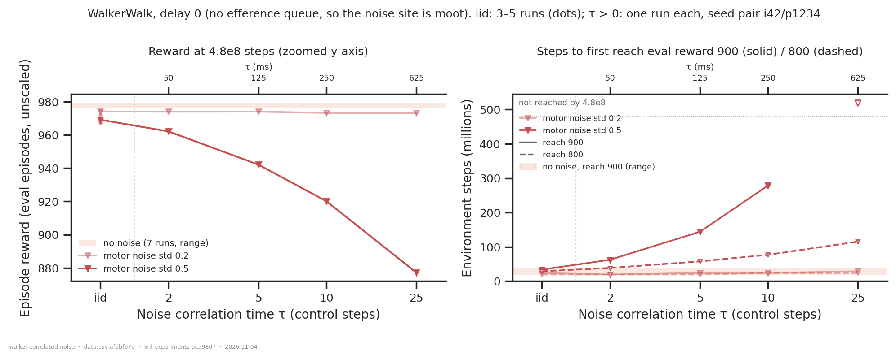
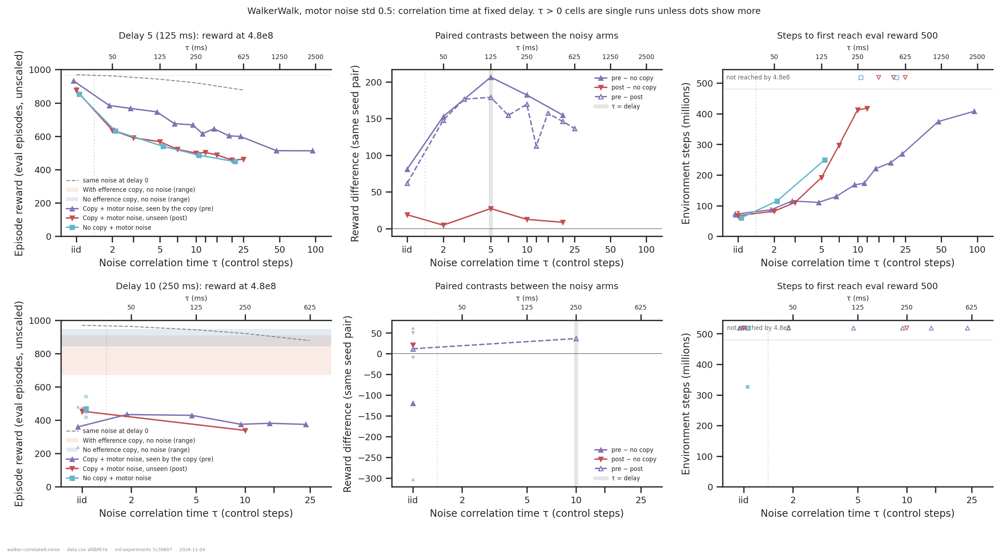
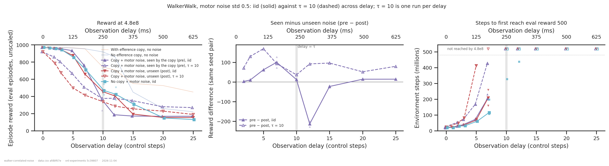
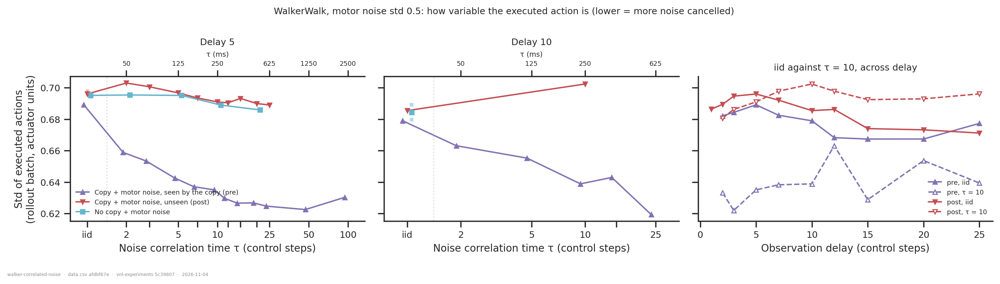
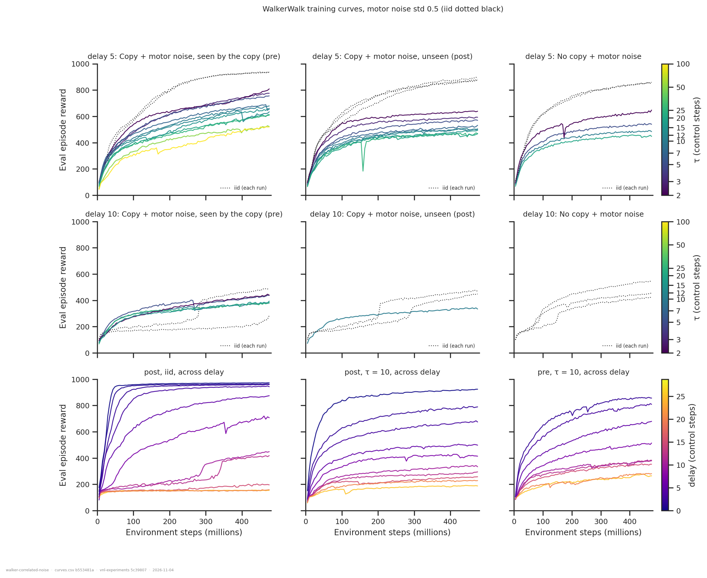

# Correlated (AR(1)) motor noise on WalkerWalk

> **Preliminary.**
> - There are 51 correlated-noise runs from two batches: 28 post / no-copy runs on
>   2026-11-03 and 23 pre runs on 2026-11-04.
> - **Every τ > 0 cell is a single run** (seed pair i42/p1234, budget 4.8e8). Read the
>   shapes and the large gaps, not differences of a few tens of reward.

## Question

`net.motor_noise_tau` (commit `5c39807`) turns the iid motor noise of
[`../walker-motor-noise/`](../walker-motor-noise/report.md) into an AR(1) process,
`n_t = ρ n_{t−1} + σ√(1−ρ²) ε_t` with `ρ = exp(−1/τ)` and τ in control steps (25 ms). The
stationary std stays σ, and each episode starts from a fresh stationary draw. The idea
behind it:
- the body filters out fast noise;
- the delayed feedback corrects slow noise;
- so noise with **τ ≈ delay** should hurt most, and be where only a copy that sees the noise
  (pre) can help.

Four questions:
1. Does the code do what it should?
2. Does τ change the results?
3. Which parameter regimes are worth pursuing?
4. Is there early evidence of the τ ≈ d band?

## Answers up front

| | answer |
|---|---|
| **Code correct?** | **Nothing points to a bug, and the pre runs now test the replay path too.** The config and run names carry τ, and all 22 invariants match. Cost changes smoothly with τ. The executed-action std of post and no-copy is constant across τ (0.686–0.703), so τ changes the timescale and not the size. Pre runs, where the replayed queue has to match the rollout, train stably. Their final clipping fraction (0.040–0.082, median ~0.05) matches iid pre (0.050–0.055) and post (0.038–0.052). They also beat post at every τ, and they visibly *use* the noise in the queue (fig. 4). A replay mismatch would show the opposite. |
| **Calibration at d0 (fig. 1)** | **Std 0.2 is harmless at every τ** (973–974, against 977–979 noise-free). **Std 0.5 costs more the slower the noise**: 969 iid, then 962, 942, 920 and 877 at τ = 2, 5, 10, 25. Steps to 900 go 38M → 62M → 144M → 278M, and τ = 25 never reaches 900. |
| **Does τ matter?** | **A lot.** At d5 every τ ≥ 2 costs 250–420 against iid, for every arm (fig. 2). The extra cost of d5 over d0 is 94 for iid post noise and 325–421 for correlated post noise. |
| **Unseen noise** | **The copy is worthless at every τ.** Post − no-copy at d5 is +5 to +27, inside the floor. |
| **Seen noise** | **Correlation roughly doubles the copy's value.** At d5, pre − no-copy is +81 for iid (2 seed pairs), then **+153, +206, +182, +155** at τ = 2, 5, 10, 20. Pre − post is +62 for iid and **+112 to +179** at all nine τ from 2 to 25. Pre also reaches 500 much faster (~110M at τ5 against ~190M for post). It still gets there up to τ = 100, while post never does from τ = 15 on. |
| **A band at τ ≈ d?** | **At most a shallow one: the advantage is a broad plateau, not a band.** At d5, pre − no-copy is largest at τ = 5 = d (+206), but only ~25–50 above its neighbours, and those are single runs. Pre − post is flat at ~150–180 over τ = 2–20. Along the *delay* axis at τ = 10, pre − post peaks at d5 (+169) and is *smallest* at d10 = τ (+37) (fig. 3). The data fit "any noise correlated over ≥ 2 steps makes the copy useful" better than "the copy is tuned to τ ≈ d". |
| **Mechanism (fig. 4)** | **The pre policy cancels the noise.** With seen noise, the executed-action std drops from 0.689 (iid) to 0.659 at τ2 and 0.62–0.63 at τ ≥ 15. Post and no-copy stay at ~0.69. So the policy removes roughly a third of the noise variance, and it can only do so when the noise persists long enough to be predicted from the queue: it removes more, the larger τ is. |
| **Learning trap** | **Correlated noise avoids the ~180 plateau** that traps iid runs at d ≥ 10. With seen noise at τ = 10, d12 and d15 read 378 and 351, against 186 and 171 for iid pre (fig. 5). |

## Dataset & comparability

- **Source:** `emiwar-team/nnx-ppo-delays`, index synced 2026-11-04 (973 runs).
  [`runs.csv`](runs.csv) has **228 WalkerWalk runs**, every one with a readout:

  | arm | runs | of which τ > 0 |
  |---|---|---|
  | noise post (copy on) | 64 | 24 |
  | noisy no-copy | 35 | 4 |
  | noise pre | 51 | 23 |
  | clean copy | 46 | – |
  | clean no-copy | 32 | – |

  Noisy runs are kept at std 0.2 and 0.5 only. The iid runs are the τ = 0 reference.

- **The τ design** (std 0.5 unless noted, one seed pair i42/p1234, 4.8e8):

  | sweep | post | no copy | pre |
  |---|---|---|---|
  | d0 calibration (site moot) | τ ∈ {2, 5, 10, 25} × std {0.2, 0.5} | – | – |
  | d5 | τ ∈ {2, 3, 5, 7, 10, 12, 15, 20, 25} | τ ∈ {2, 5, 10, 20} | τ ∈ {2, 3, 5, 7, 10, 12, 15, 20, 25, **50, 100**} |
  | d10 | τ = 10 | – | τ ∈ {2, 5, 10, 15, 25} |
  | τ = 10 across delay | d ∈ {2, 3, 5, 7, 10, 12, 15, 20, 25} | – | d ∈ {2, 3, 5, 7, 10, 12, 15, 20, 25} |

  The 18 iid std 0.2 runs from 2026-10-29 (pre and noisy no-copy, d1–d25) are included as
  references. `../walker-motor-noise/` does not have them yet; it needs a `--refresh`.
- **Gates:** as in `../walker-motor-noise/`:
  - network: `DelayedMLP`, privileged critic, `min_std` 0.001, torque, no distillation;
  - era: post-`d168093`;
  - budget: ≥ 4.8e8.
- **Readouts:**
  - `reward`: the mean of the eval points in (4.3e8, 4.8e8], under the run's own noise.
  - `steps_to_{500,800,900,950}`: searched only up to 4.8e8, so every run shares one
    horizon.
  - `batch_action_std`: the std of the *executed* (post-noise) rollout actions, pooled
    over envs, time and the readout window.
- **Programmatic comparability** ([`comparability.txt`](comparability.txt)): all 22
  invariants are single-valued within every condition. History coverage is 228/228 for
  both specs ([`coverage.txt`](coverage.txt)).
- **Manual comparability:**
  - Every τ > 0 run is at `5c39807`, nnx-ppo `21d6643`. The diff from the iid runs'
    `2f66835` touches only the motor-noise module, its builders and tests, the run name,
    `style.py`, and analysis files. τ = 0 is the original code path, pinned by the goldens.
  - 44 of 51 τ runs had a dirty working copy. **7 pre runs did not**: d5 at τ = 2, 5, 10,
    15, 20, 25 and 50. They sit on the same curve as their dirty neighbours (fig. 2), so
    there is no sign that the dirty runs ran different code.
  - GPUs are mixed (H200 / A100).
- **Run-to-run floor:** same config and seed pair on two GPUs differ by 4 at d0 and up to
  ~20 at d5 (`../walker-motor-noise/`). Every τ > 0 cell is one run, so treat
  differences below ~30 as unresolved and paired contrasts below ~50 as soft.

## Figures



**Figure 1: correlated noise at delay 0.** The τ axis is logarithmic, with iid in its own
slot on the left. The shaded band is the noise-free range.
- **Left, reward (zoomed y-axis):**
  - Std 0.2 is flat at 973–974 for every τ.
  - Std 0.5 falls steadily from 969 (iid) to 877 at τ = 25.
- **Right, time to solve:**
  - Std 0.2 is as fast as noise-free.
  - At std 0.5, reaching 900 slows from 38M to 278M (τ10), and τ25 never gets there.
  - Slow noise costs mostly the last ~100 reward.



**Figure 2: correlation time at fixed delay (std 0.5).**
- **d5, reward (top left):**
  - Post (red) and noisy no-copy (cyan) lie on one curve, falling from ~860 (iid) to ~450.
  - Pre (purple) sits 110–180 above them at every τ, and falls more gently, to ~600 at
    τ = 20–25 and 513 at τ = 50–100.
  - The grey dashed line is the same noise at d0.
- **d5, paired contrasts (top middle):**
  - Post − no-copy hugs zero.
  - Pre − no-copy rises from +81 (iid) to a maximum of +206 at τ = 5 = d (grey bar), then
    falls to +155 at τ = 20.
  - Pre − post (dashed) shows the same rise but is flatter, at 112–179.
  - The bump at τ = d is one run per point.
- **d5, steps to 500 (top right):**
  - Pre gets there at every τ up to 100, needing longer the larger τ is (85M → 410M).
  - Post and no-copy get there only up to τ ≈ 10.
- **d10 (bottom row):**
  - Pre reads 375–434 at every τ, flat, and above iid pre (360, whose two runs are 239 and
    481 because of the trap).
  - Only τ = 10 has a post partner (+37). No noisy no-copy run exists at d10 with τ > 0,
    so the advantage panel is nearly empty.
  - Nothing reaches 500 by 4.8e8.



**Figure 3: iid against τ = 10 across delay (std 0.5).**
- **Left, reward:**
  - With iid noise (solid), the arms coincide out to d7, and pre then collapses into the
    trap at d12–15.
  - With τ = 10 (dashed), pre sits above post at every delay.
- **Middle, pre − post, paired:**
  - τ = 10 is positive everywhere: +71, +130, +169, +93 at d2–7, **+37 at d10 = τ**, and
    +52 to +96 beyond.
  - iid is ~0 except at d5–7 (+62, +100) and the trap at d12 (−218).
  - So the τ = 10 advantage peaks at **d5 ≈ τ/2**, not at d = τ.
- **Right, steps to 500:** τ = 10 pre reaches 500 out to d7; τ = 10 post only to d5.



**Figure 4: how variable the executed action is.** This is the std of the actions the body
actually receives, intended action plus noise, pooled over the rollout batch.
- **Post and no-copy** sit at 0.69–0.70 at every τ and delay. That is the policy's own
  spread plus the full noise.
- **Pre** falls steadily with τ:
  - d5: 0.689 (iid) → 0.659 (τ2) → 0.642 (τ5) → 0.63 (τ ≥ 12);
  - d10: 0.679 → 0.62 at τ25;
  - across delay at τ = 10: 0.62–0.66, against ~0.70 for post.
- **Reading:** the policy steers against the noise it can see in the queue. That needs the
  noise to persist until the next action, so it only works for correlated noise, and works
  better the larger τ is. Relative to post, pre at τ ≥ 15 removes about
  0.69² − 0.63² ≈ 0.08 of variance, i.e. about a third of the noise's 0.25.
- This is a direct mechanistic signature of the copy being used. It does not depend on
  reward.



**Figure 5: training curves at std 0.5.**
- **Top (d5), colour = τ:**
  - Post and no-copy level off by ~100M steps.
  - **Pre keeps climbing through 4.8e8 at every τ**, steepest at τ = 50–100. The 4.8e8
    readout therefore probably understates the pre advantage, especially at large τ.
- **Middle (d10):**
  - All five pre τ runs rise straight away.
  - The iid runs (dotted) sit on the ~180 plateau for 100–400M steps before escaping.
- **Bottom, colour = delay:**
  - iid post shows the plateau from d10 on.
  - Both τ = 10 arms (post, pre) rise smoothly at every delay, and pre ends higher.

## Interpretation (hedged)

- **The noise does what it was built to do, and more strongly than the iid version.**
  Correlated, seen noise gives the copy a job. At d5 the copy is worth +150 to +200, about
  twice the iid value, and the policy demonstrably uses it to cancel the noise (fig. 4).
  Correlated *unseen* noise gives the copy nothing, at any τ.
- **There is no clear band.** The value of the copy rises from iid to τ ≈ 2–5 and then
  declines only slowly out to τ = 25, at d5 and at d10 alike. Along the delay axis
  (τ = 10) it peaks at d5, not at d = 10. Two reasons the band argument may not apply as
  stated:
  1. **The upper edge assumed that delayed feedback corrects slow noise.** A memoryless
     MLP cannot do that: it can't estimate a persistent offset, and slow noise hurts even
     at d0 (fig. 1). A copy that sees the noise *does* reveal the offset, so for this
     network the copy stays useful however slow the noise is. The predicted fall-off at
     τ ≫ d would only appear for a controller with memory.
  2. **The lower edge is real, but sits at τ of about 1–2 steps, not at d.** The copy can
     only cancel noise that persists to the next action. That depends on ρ, not on the
     delay, and ρ is already 0.6 at τ = 2.
- **What the delay does change is how much there is to recover**, not where along τ the
  copy helps. At τ = 10 the advantage shrinks from d5 to d10. That is consistent with the
  queue at d10 covering 250 ms of noise that has largely changed by the time the
  observation catches up.
- **Correlated noise removes the learning trap** at d ≥ 10, for pre as well as post. That
  makes the long delays usable for this question, which iid noise never allowed.
- **The 4.8e8 budget is short for pre.** Its curves are still rising, most steeply at
  large τ. A peak-versus-plateau question about τ needs these runs read later (1e9).

## Recommendations

| priority | runs | why |
|---|---|---|
| 1 | **Seeds for the d5 τ sweep**: pre / post / no-copy at τ ∈ {2, 5, 20}, 2 more seed pairs, **1e9** | every claim above rests on one seed per τ. 1e9 because the pre curves are still rising. |
| 2 | **post and no-copy at d5, τ ∈ {50, 100}** (+ `inf`) | pre exists there, but has nothing to be paired with. This is the test of the band's upper edge: does the copy's value fall off at τ ≫ d? |
| 3 | **post and no-copy at d10, τ ∈ {2, 5, 25}** | d10 has pre at five τ but only one post partner and no no-copy. With partners, d10 becomes a second delay to compare the τ-profile against d5. |
| 4 | **`FlatRecurrent` at d0 and d5, τ ∈ {10, 25}, post** | tests the memoryless explanation. If an RNN removes the d0 cost of slow noise, the upper band edge should appear for it, and this is where an error-correcting forward model is predicted to help. |
| 5 | (optional) **std 0.3** at d5 for τ ∈ {2, 10} | a smaller std that still separates the arms, at lower cost. |

```bash
# 1: seeds at 1e9 (seed pairs i43/p43, i44/p44); pre shown, swap site / efference=0 for the others
for s in 43 44; do for tau in 2 5 20; do
  sbatch slurm_dmc_requeue.sh env=dmc/walker_walk net=delayed_mlp train=dmc delay=5 \
      net.motor_noise_std=0.5 net.motor_noise_tau=$tau net.motor_noise_site=pre_efference \
      seed=$s train.seed=$s train.ppo.total_steps=1000000000
done; done
# 2 / 3: pair with the existing i42/p1234 runs, so only seed=42 (train.seed default 1234)
for tau in 50 100 inf; do
  sbatch slurm_dmc_requeue.sh env=dmc/walker_walk net=delayed_mlp train=dmc delay=5 \
      net.motor_noise_std=0.5 net.motor_noise_tau=$tau seed=42             # post
  sbatch slurm_dmc_requeue.sh env=dmc/walker_walk net=delayed_mlp train=dmc delay=5 \
      net.motor_noise_std=0.5 net.motor_noise_tau=$tau seed=42 efference=0 # no copy
done
```
