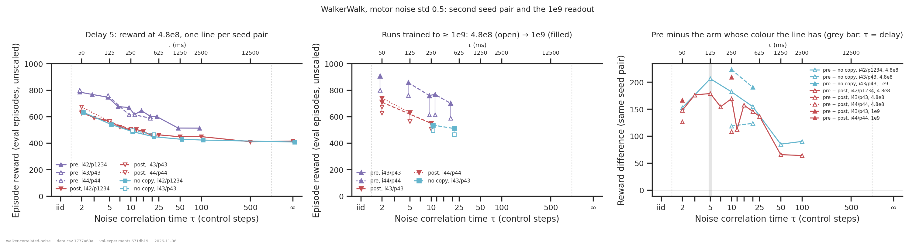
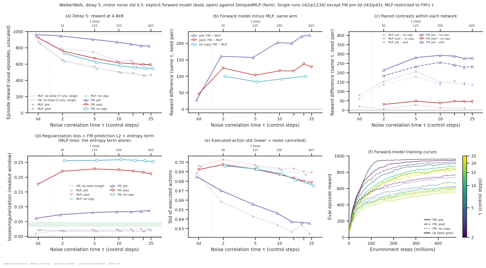

# Correlated (AR(1)) motor noise on WalkerWalk

> **Preliminary.**
> - There are 72 `DelayedMLP` correlated-noise runs from four batches (2026-11-03 to
>   11-06), and a first look at **`FlatForwardModel` under motor noise**: 20 runs at d5,
>   on 2026-11-06 (fig. 7).
> - Most τ > 0 cells are **one run**, from seed pair i42/p1234 at 4.8e8.
> - At d5, some cells have more seed pairs:
>   - i43/p43, trained to 1e9: pre at τ = 5, 10, 12, 20; post at τ = 2, 10; no-copy at
>     τ = 10, 20;
>   - i44/p44, trained to 2e9 (read at 4.8e8 and 1e9): pre at τ = 2; post at τ = 2, 5.
> - Read shapes and large gaps, not differences of a few tens of reward.

## Question

`net.motor_noise_tau` (commit `5c39807`) turns the iid motor noise of
[`../walker-motor-noise/`](../walker-motor-noise/report.md) into an AR(1) process,
`n_t = ρ n_{t−1} + σ√(1−ρ²) ε_t` with `ρ = exp(−1/τ)` and τ in control steps (25 ms).

The process starts each episode from a fresh draw of the stationary distribution, and the
stationary std stays σ. So the noise is equally large at every step of an episode,
including the first (`MotorNoise.__call__`; the carry is re-flagged as fresh on every
reset, on resume and in eval).

The idea behind it:
- the body filters out fast noise;
- delayed feedback corrects slow noise;
- so noise with **τ ≈ delay** should hurt most, and be where only a copy that sees the
  noise (pre) can help.

Four questions:
1. Does the code do what it should?
2. Does τ change the results?
3. Which parameter regimes are worth pursuing?
4. Is there evidence of the τ ≈ d band?

## Answers up front

| | answer |
|---|---|
| **Code correct?** | **Nothing points to a bug.** The config and run names carry τ, and all 22 invariants match. Cost changes smoothly with τ. The executed-action std of post and no-copy is constant across τ ≤ 25 (0.686–0.703). Pre runs exercise the replay path: they train stably, with a normal clipping fraction (0.040–0.082 against 0.038–0.055), and they visibly use the queue (fig. 5). **The second seed pair reproduces the first** at 4.8e8 (fig. 3): pre 760 / 614 / 613 / 588 against 746 / 668 / 615 / 603 at τ = 5 / 10 / 12 / 20; post 505 against 499; no-copy 495 / 465 against 486 / 448. A third seed pair (i44) agrees: pre τ2 799 against 784; post τ2 673 against 637 / 626, and τ5 563 against 567. |
| **Calibration at d0 (fig. 1)** | **Std 0.2 is harmless at every τ.** **Std 0.5 costs more the slower the noise**: 969 iid, then 962, 942, 920, 910, 900 and 877 at τ = 2, 5, 10, 12, 15, 25. τ = 12 and 15 recover to 936 and 928 by 1e9, so part of that cost is learning speed. |
| **Does τ matter?** | **A lot.** At d5 every τ ≥ 2 costs 250–460 against iid in every arm (fig. 2). The cost saturates at τ ≳ 50: post reads 448 at τ50, 449 at τ100, 410 at τ500 and 415 at τ = ∞. So τ ≥ 500 behaves like a per-episode offset. |
| **Unseen noise** | **The copy is worthless at every τ**, including ∞. Post − no-copy at d5 is +5 to +27 over the 8 paired τ values. |
| **Seen noise** | **Correlation roughly doubles the copy's value, and the gain keeps growing with training.** At 4.8e8 (i42), pre − no-copy at d5 is +81 for iid, then +153, +206, +182, +155 at τ = 2, 5, 10, 20. Pre − post is 112–179 across τ = 2–25. In the 1e9 seed pair (i43), pre − no-copy is +119 / +124 at 4.8e8 at τ = 10 / 20, rising to **+223 / +190 at 1e9**, and pre − post is +109 → **+210** at τ10. Over that time pre gains 96–154 and post / no-copy gain 41–45. |
| **A band at τ ≈ d?** | **Yes, but a broad one, and it peaks at τ ≈ 0.5–1 × d.** At d5 the copy's value (i42, 4.8e8) rises from iid (+81) to a maximum at τ ≈ 3–5 (+176 to +206). It holds at ~110–180 out to τ = 25 = 5d, then **falls to +85 / +90 at τ = 50 / 100** (pre − post +66 / +64). Two qualifications. (1) Along the delay axis at τ = 10, pre − post is largest at d5 = τ/2 (+169) and smallest at d10 = τ (+37), so the band does not simply track τ = d. (2) Pre at τ = 50–100 is still climbing steeply at 4.8e8 (fig. 6), so the drop at large τ may partly be learning speed. Those two cells need 1e9. |
| **Mechanism (fig. 5)** | **The pre policy cancels the noise it sees.** Its executed-action std drops from 0.689 (iid) to ~0.63 at τ ≥ 12, in both seed pairs (τ5: 0.642 and 0.643). Post and no-copy stay at ~0.69 up to τ = 25. At τ ≥ 50 they drift down too (no-copy 0.678 / 0.670 / 0.668 at τ = 50 / 100 / ∞). Policies without the copy therefore begin to counter very slow noise through the state alone, which is the band's predicted upper edge. |
| **Explicit forward model (fig. 7, first look)** | **The forward model is much more robust to correlated noise than `DelayedMLP`, in every arm.** Noise-free at d5 the two are equal (973–974 against 962–967). At d5, std 0.5, τ = 2 / 5 / 10 / 15 / 20 / 25 (single runs): **(1) Seen noise:** 945 / 903 / 870 / 845 / 824 / 823, **+157 to +225 above `DelayedMLP`**. At τ = 25 it is 54 below the same noise at d0, against 278 for `DelayedMLP`. **(2) Unseen noise:** 762 → 590, **+103 to +138 above `DelayedMLP`**. **(3) No copy:** 732 / 623 / 578 / 557 / 548 / 545, **+83 to +100 above `DelayedMLP` no-copy**. So about +90 of the forward model's edge needs no action buffer at all. **Breakdown within the forward model:** the intended actions in the buffer add +30 to +48 (post − no-copy; ~0 for `DelayedMLP`), and seeing the noise adds +183 to +255 more (pre − post). Pre − no-copy is +213 at τ = 2 and +276 to +293 at τ = 5–25. **Prediction error** (regularization loss = predictor L2 + ~0.02 entropy): 0.25–0.26 with no copy, 0.21–0.23 with unseen noise, 0.07–0.09 with seen noise, 0.03–0.05 noise-free. Intended actions remove a little of the error; executed actions remove most of it. |
| **Learning trap** | **Correlated noise avoids the ~180 plateau** that traps iid runs at d ≥ 10. With seen noise at τ = 10, d12 and d15 read 378 and 351, against 186 and 171 for iid pre (fig. 6). |

## Dataset & comparability

- **Source:** `emiwar-team/nnx-ppo-delays`, index synced 2026-11-06 (1013 runs).
  [`runs.csv`](runs.csv) has **296 WalkerWalk runs**, every one with a readout:

  | network | arm | runs | of which τ > 0 |
  |---|---|---|---|
  | `DelayedMLP` | noise post (copy on) | 74 | 35 |
  | | noisy no-copy | 40 | 9 |
  | | noise pre | 56 | 28 |
  | | clean copy | 46 | – |
  | | clean no-copy | 32 | – |
  | `FlatForwardModel` | noise post | 7 | 6 |
  | | noise pre | 7 | 6 |
  | | noisy no-copy | 6 | 6 |
  | | clean (eff = delay), d0–d30 | 28 | – |

  Noisy runs are kept at std 0.2 and 0.5 only. The iid runs are the τ = 0 reference.

- **The τ design** (std 0.5 unless noted; i42 = seed pair i42/p1234 at 4.8e8; i43 =
  i43/p43 at 1e9):

  | sweep | post | no copy | pre |
  |---|---|---|---|
  | d0 (site moot) | τ ∈ {2, 5, 10, 25} × std {0.2, 0.5}; τ ∈ {12, 15} at 1e9 | – | – |
  | d5, i42 | τ ∈ {2, 3, 5, 7, 10, 12, 15, 20, 25, 50, 100, 500, ∞} | τ ∈ {2, 5, 10, 20, 50, 100, ∞} | τ ∈ {2, 3, 5, 7, 10, 12, 15, 20, 25, 50, 100} |
  | d5, i43 | τ = 10 | τ ∈ {10, 20} | τ ∈ {5, 10, 12, 20} |
  | d10, i42 | τ = 10 | – | τ ∈ {2, 5, 10, 15, 25} |
  | τ = 10 across delay, i42 | d ∈ {2, 3, 5, 7, 10, 12, 15, 20, 25} | – | d ∈ {2, 3, 5, 7, 10, 12, 15, 20, 25} |
  | d5, i44 (2e9) | τ ∈ {2, 5} | – | τ = 2 |
  | **`FlatForwardModel`** d5, i42 | iid, τ ∈ {2, 5, 10, 15, 20, 25} | τ ∈ {2, 5, 10, 15, 20, 25} | τ ∈ {2, 5, 10, 15, 20, 25}; iid at i43 |

  The seen-noise `FlatForwardModel` runs at τ = 5 and 10 crashed on the first attempt and
  were restarted (`0fiaklto`, `cdkfb5rs`). The `FlatForwardModel` no-copy runs have
  `efference=0`, so the predictor sees the delayed observation only.

  The 18 iid std 0.2 runs from 2026-10-29 are included as references.
  `../walker-motor-noise/` does not have them yet; it needs a `--refresh`.
- **Gates:** as in `../walker-motor-noise/`:
  - network: `DelayedMLP`, privileged critic, `min_std` 0.001, torque, no distillation;
  - era: post-`d168093`;
  - budget: ≥ 4.8e8.
- **Readouts:**
  - `reward`: the mean of the eval points in (4.3e8, 4.8e8], under the run's own noise.
    This is the comparison readout, so 1e9 runs pool with 4.8e8 ones; nnx-ppo has no
    schedule, so a 1e9 run read at 4.8e8 is a 4.8e8 run.
  - `reward_1b`: the same window ending at 1e9, for runs that reach it.
  - `steps_to_{500,800,900,950}`: searched only up to 4.8e8, a shared horizon.
  - `batch_action_std`: the std of the *executed* (post-noise) rollout actions.
  - `reg_loss`: `losses/regularization/mean` over the readout window. For
    `FlatForwardModel` that is the predictor's L2 loss (weight 1) plus the sampler's
    entropy term. The entropy term alone is what `DelayedMLP` reports, 0.016–0.029 with
    noise. `fm_pred_mse` itself is not logged, so this is the best available measure of
    prediction error.
- **Programmatic comparability** ([`comparability.txt`](comparability.txt)): all 22
  invariants are single-valued within every condition, including the
  `FlatForwardModel` ones (same actor widths, `fm_loss_weight` 1, detached prediction).
  History coverage is 296/296 for all three specs ([`coverage.txt`](coverage.txt)).
- **Manual comparability:**
  - Every `DelayedMLP` τ > 0 run is at `5c39807`, nnx-ppo `21d6643`. The noisy
    `FlatForwardModel` runs are at `c72ed04`, which adds motor noise to that network. That
    diff leaves noise-free layouts unchanged, as the reload regression tests pin. The diff from the iid runs'
    `2f66835` touches only the motor-noise module, its builders and tests, the run name,
    `style.py`, and analysis files.
  - 55 of 68 τ runs had a dirty working copy. The 13 clean ones sit on the same curves as
    their dirty neighbours (e.g. pre τ = 2, 5, 10, 15, 20, 25, 50 at d5; post τ = 50,
    100, 500 at d5).
  - GPUs are mixed (H200 / A100).
- **Run-to-run floor:**
  - Same config and seed pair on two GPUs: 4 apart at d0, up to ~20 at d5.
  - Across seed pairs at d5 with τ > 0 (fig. 3): 6–54 apart at 4.8e8, the largest being
    pre τ = 10 (668 against 614).
  - Treat single-run differences below ~50 as unresolved, and paired contrasts below
    ~60 as soft.

## Figures


**Figure 1: correlated noise at delay 0.** The τ axis is logarithmic, with iid in its own
slot on the left. The shaded band is the noise-free range.
- **Reward:** std 0.2 is flat at 973–974. Std 0.5 falls steadily from 969 (iid) to 877
  at τ = 25.
- **Steps to 900:** 38M (iid), 62M, 144M, 278M, 360M and 410M at τ = 2–15, and never at
  τ = 25.
- The d0 cost is mostly learning speed on the last ~100 reward: τ = 12 / 15 reach
  936 / 928 by 1e9.


**Figure 2: correlation time at fixed delay (std 0.5).** The x-axis has iid at the left
and ∞ at the right, each in its own slot. Lines are means over the runs in a cell (dots
= single runs).
- **d5, reward (top left):**
  - Post and no-copy lie on one curve, flattening at ~410–450 from τ = 50 on.
  - Pre sits clearly above them out to τ = 25. Its margin is smaller at τ = 50–100.
- **d5, paired contrasts (top middle):**
  - Post − no-copy hugs zero everywhere, including ∞.
  - Pre − no-copy and pre − post peak at τ ≈ 3–5 (grey bar = τ = d). They stay high to
    τ = 25, then fall by about half at τ = 50–100.
  - The mean at τ = 10 averages the two seed pairs (+182 and +119).
- **d5, steps to 500 (top right):**
  - Pre gets there at every τ up to 100, needing longer the larger τ is.
  - Post and no-copy get there only up to τ ≈ 10.
- **d10 (bottom):**
  - Pre reads 375–434 at every τ.
  - Only one post partner exists (τ = 10, +37), and no no-copy run, so the contrast row
    is nearly empty.



**Figure 3: replication and the longer budget (d5).**
- **Left, reward at 4.8e8 with one line per seed pair:**
  - The i43 runs (open markers, dashed) fall on the i42 curves.
  - The largest gap is pre at τ = 10 (614 against 668).
- **Middle, runs trained to ≥ 1e9, 4.8e8 (open) and 1e9 (filled):**
  - i43 pre gains 96–154: 856 / 759 / 767 / 700 at τ = 5 / 10 / 12 / 20.
  - Post and no-copy gain 41–45, reaching 549 / 536 / 510.
  - i44 (2e9 budget, read at 1e9): pre τ2 799 → 907, post τ2 673 → 740, post τ5
    563 → 629.
- **Right, contrasts** (cyan = minus no-copy, red = minus post; solid = i42 at 4.8e8,
  dashed open = i43 at 4.8e8, filled = i43 at 1e9):
  - The i43 contrasts at 4.8e8 are ~50 below i42's (+109 to +124 against +150 to +182).
  - By 1e9 they reach +190 to +223, above anything at 4.8e8.
  - The new τ = 2 points (i44) give pre − post +126 at 4.8e8 and +167 at 1e9.


**Figure 4: iid against τ = 10 across delay (std 0.5).**
- **Reward:**
  - iid arms coincide out to d7, then pre falls into the trap at d12–15.
  - With τ = 10, pre is above post at every delay.
- **Pre − post:**
  - +71, +130, +169, +93 at d2–7, +37 at d10 = τ, and +52 to +96 beyond.
  - The peak is at d5 ≈ τ/2.


**Figure 5: how variable the executed action is** (intended + noise, pooled over the
rollout batch).
- **Post and no-copy:** 0.69–0.70 at every τ up to 25, then drifting to 0.67–0.68 at
  τ ≥ 50.
- **Pre:** falls from 0.689 (iid) to 0.659 (τ2), 0.642 (τ5) and ~0.63 at τ ≥ 12, the same
  in both seed pairs. Also lower across delay at τ = 10: 0.62–0.66, against ~0.70 for
  post.
- **Reading:**
  - The pre policy steers against noise it can see in the queue, and removes roughly a
    third of the noise variance.
  - At τ ≥ 50 the policies *without* the copy start to do a little of the same, through
    the delayed state alone. The difference the copy makes shrinks, consistent with the
    smaller reward advantage there.


**Figure 6: training curves at std 0.5, out to 1e9** (dashed line = 4.8e8 readout).
- **d5:**
  - Post and no-copy level off by ~100M.
  - Pre keeps climbing, through 1e9 for the i43 runs.
  - Pre at τ = 50–100 (green) is still climbing steeply at 4.8e8.
  - τ = ∞ (red dashed) is the lowest curve in the post and no-copy panels.
- **d10:**
  - The pre τ runs rise straight away.
  - The iid runs (dotted) sit on the ~180 plateau for 100–400M steps before escaping.
- **Bottom, colour = delay:**
  - iid post shows the plateau from d10 on.
  - Both τ = 10 arms rise smoothly at every delay, and pre ends higher.



**Figure 7: explicit forward model under motor noise (d5, first look).** Colour = noise
placement; bold open markers = `FlatForwardModel`, faint = `DelayedMLP` restricted to the
same τ values. Single runs (i42/p1234), except FM pre iid (i43/p43).
- **(a) Reward:**
  - FM pre falls slowly, from 962 (iid) and 945 (τ2) to ~825 at τ = 15–25.
  - FM post falls from 924 (iid) to ~590; FM no-copy from 732 (τ2) to 545.
  - Every FM arm sits far above its `DelayedMLP` counterpart.
  - The noise-free bands of the two networks overlap at ~965–975.
- **(b) FM minus MLP, same arm and seed pair:**
  - iid: +28 (pre), +47 (post).
  - τ ≥ 2: +157 to +225 (pre), +103 to +138 (post), +83 to +100 (no copy).
  - The no-copy line is the forward model's edge without any action buffer.
- **(c) Paired contrasts within each network** (FM bold, MLP faint):
  - FM pre − no-copy is +213 (τ2) and +276 to +293 (τ ≥ 5), against MLP's +150 to +206.
  - FM pre − post is +183 to +255, against MLP's +137 to +179.
  - FM post − no-copy is a steady **+30 to +48**, against MLP's +5 to +27. So the
    intended actions help the predictor a little, even without the noise.
  - Within the FM, the copy's value is flat from τ = 5 to τ = 25, with no peak at τ = d.
- **(d) Regularization loss**, the predictor's L2 plus ~0.02 of entropy term (the MLP
  lines show the entropy term alone):
  - FM no-copy: 0.25–0.26, flat in τ;
  - FM post: 0.18 (iid), 0.21–0.23 at τ > 0;
  - FM pre: 0.06–0.09;
  - noise-free FM band: 0.03–0.05.

  So intended actions cut the prediction error by ~0.035, executed actions by ~0.17.
- **(e) Executed-action std:**
  - FM pre cancels the noise much like MLP pre: 0.646 at τ = 10, 0.636–0.637 at
    τ = 15–25.
  - FM post and no-copy drift together down to ~0.68 at τ = 25.
- **(f) FM training curves:**
  - FM pre at τ ≥ 10 (solid) is still climbing at 4.8e8.
  - FM post (dashed) and no-copy (dotted) are flatter, and no-copy sits lowest at every τ.

## Interpretation (hedged)

- **The noise does what it was built to do.** Correlated, seen noise gives the copy a
  job: at d5 it is worth +150 to +200 at 4.8e8 and ~+200 at 1e9, about twice the iid
  value. The policy demonstrably uses it to cancel the noise (fig. 5). Correlated
  *unseen* noise gives the copy nothing, at any τ including a fixed offset.
- **There is a band in τ, but it is broad, and it does not sit at τ = d.**
  - **The lower edge is real.** The copy can only cancel noise that persists to the
    next action, and that depends on ρ alone: ρ is already 0.6 at τ = 2. At d5 the gain
    from iid to τ = 2 is the largest single step.
  - **An upper edge appears at τ ≈ 10–20 d.** There, policies without the copy start to
    counter the noise through the delayed state, and the copy's margin halves. Earlier I
    wrote that a memoryless MLP cannot correct slow noise, and that is too strong: it
    partly can once the noise is slow enough that the delayed state reflects it. The
    d0 cost (fig. 1) shows it never fully does.
  - **Along the delay axis** (τ = 10), the copy's value peaks at d ≈ τ/2 and dips at
    d = τ. With one run per delay, that dip (+37) is within the softness of a paired
    contrast. It needs a second seed before it means anything.
- **The copy's value is still growing at 4.8e8**, most at large τ. Any statement about
  the *shape* of the band needs the 1e9 readout across the τ axis, not just at τ = 5–20.
- **The explicit forward model handles correlated noise far better than the plain copy**
  (fig. 7, single runs).
  - **With seen noise** it recovers most of what the delay costs: 823 at τ = 25,
    against 877 for `DelayedMLP` at d0 with the same noise.
  - **Most of its edge under unseen noise does not come from the action buffer.** The
    no-copy forward model, whose predictor sees only the delayed observation, is still
    +83 to +100 above `DelayedMLP` no-copy. The intended-action buffer adds another
    +30 to +48 on top. So "the forward model knows the noise" is not the explanation:
    its predictor visibly fails to predict the noise (0.21–0.26 L2). Candidates for the
    ~+90:
    - the decoder gets a smoother estimate of the current state than the raw delayed obs;
    - the L2 target (the true current obs) is a dense, privileged training signal that
      shapes a better representation;
    - under noise, the extra predictor capacity matters where it did not without.

    The architecture-only ablation (`fm_loss_weight=0`, `detach_prediction=false`), run
    as no-copy under noise, would separate the training signal from the other two.
  - **Seeing the noise is still the largest single factor** for the forward model:
    pre − post is +183 to +255, larger than in `DelayedMLP`. A predictor told the
    executed actions can track where the noise has pushed the body; one told the
    intended actions cannot.
  - **The error-correcting forward model** (the reason correlated post noise was built) is
    a different network: one that feeds its own past prediction error back in. The 4×
    larger, τ-independent L2 loss under unseen noise is exactly the signal such a network
    would exploit. At τ ≥ 2 the error is correlated over time, so a past error predicts
    the next one.
- **Correlated noise removes the learning trap** at d ≥ 10, for pre as well as post. The
  long delays are therefore usable for this question, which iid noise never allowed.

## Recommendations

| priority | runs | why |
|---|---|---|
| 1 | **d5 at 1e9, i43/p43, filling the τ axis**: pre / post / no-copy at τ ∈ {2, 50, 100, ∞}, plus post at τ ∈ {5, 20} and no-copy at τ = 5 | turns the i43 sweep into a complete 1e9 band. The upper edge (τ = 50–100) is the cell most likely to move with budget. |
| 2 | **pre at d5, τ ∈ {500, ∞}** (i42, 4.8e8) | post and no-copy exist there but pre does not. This completes the upper edge at 4.8e8. |
| 3 | **post and no-copy at d10, τ ∈ {2, 5, 25}** (i42) | d10 has pre at five τ but almost nothing to pair it with. A second delay is the only way to see whether the band moves with d. |
| 4 | **`FlatForwardModel` follow-ups at d5**: (a) a second seed pair for FM pre / post / no-copy at τ ∈ {2, 10, 25}; (b) the architecture-only ablation `fm_loss_weight=0 detach_prediction=false`, no-copy and post, at τ ∈ {2, 10, 25}; (c) FM at d0 with noise at τ ∈ {10, 25} | (a) firms up fig. 7, which is all single runs. (b) tells whether the ~+90 the FM has without any buffer comes from the L2 training signal or the architecture. (c) is the forward model's own d0 reference, so its delay cost need not be read against `DelayedMLP`'s d0. |
| 5 | **`FlatRecurrent` with noise** | the memory question: can recurrence recover the post / no-copy loss at large τ? |

```bash
# 1: i43/p43 at 1e9; post shown, add net.motor_noise_site=pre_efference or efference=0
for tau in 2 50 100 inf; do
  sbatch slurm_dmc_requeue.sh env=dmc/walker_walk net=delayed_mlp train=dmc delay=5 \
      net.motor_noise_std=0.5 net.motor_noise_tau=$tau seed=43 train.seed=43 \
      train.ppo.total_steps=1000000000
done
# 2: pair with i42/p1234 (train.seed's default 1234), 4.8e8
for tau in 500 inf; do
  sbatch slurm_dmc_requeue.sh env=dmc/walker_walk net=delayed_mlp train=dmc delay=5 \
      net.motor_noise_std=0.5 net.motor_noise_tau=$tau \
      net.motor_noise_site=pre_efference seed=42
done
```
