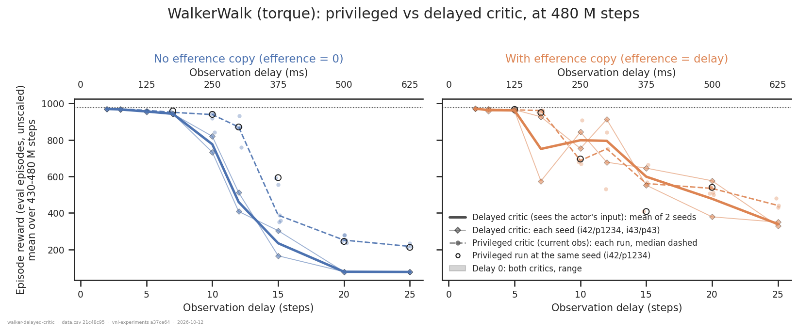
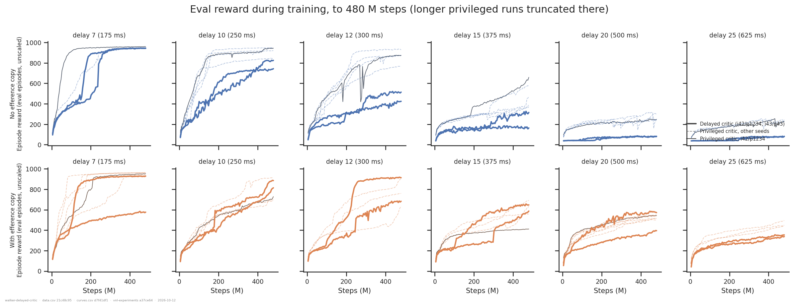
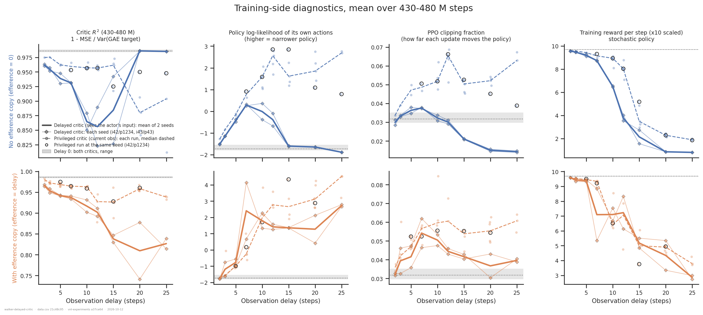
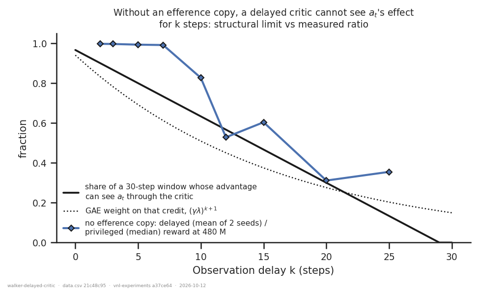

# Does PPO under delay need a privileged critic? WalkerWalk, torque control

> **Updated 2026-10-12** with a second delayed-critic seed (i43/p43): 19 runs covering both
> arms at every delay, plus delay 0. It **confirms** the no-copy result: all 18 delayed
> runs are below every privileged run at delays ≥ 10. It **revises** the efference-copy
> result. The delay-20 deficit reported on 2026-10-09 was seed noise: the new seed scores
> 577 there, above every privileged run. Two cells where both seeds sit below the
> privileged range remain: delay 25 (clearly) and delay 7 (one seed stalled). See
> [What changed on 2026-10-12](#what-changed-on-2026-10-12).

## Question

Every delay run in this project has used an **asymmetric** actor-critic: the actor sees the
observation `delay_k` steps late (plus, in the efference arm, the actions taken since),
while the critic sees the *current* observation. `a37ce64` added a non-privileged option
(`net.privileged_critic=false`), in which the critic receives exactly the actor MLP's input:
the delayed observation, plus the efference queue when there is one.

How much does the privilege buy, and does that depend on the efference copy? An answer is,
per delay and efference arm, the delayed-critic reward at 480 M steps read against the
privileged arm's seed spread. Where the privileged arm has a run at a delayed seed, that
matched pair is read too.

## Answers up front

| | answer |
|---|---|
| **With an efference copy** | **About as good as privileged from delay 2 to 20 (50–500 ms), with a deficit at 25 (625 ms).** Across both seeds, the delayed runs sit at a mean percentile of 0.57 within the privileged cloud, where 0.5 is what another privileged seed would score. Each seed lands above the cloud at some delays and below it at others (e.g. delay 20: 577 above the privileged 500–543, 379 below). At delay 25 both seeds are below every privileged run (350, 329 vs 429–480). At delay 7 one seed stalled on the lower plateau (575 vs 939–962) and the other is just below the range (927). |
| **Without an efference copy** | **A large cost from delay 10 on, in both seeds.** Every one of the 10 delayed runs at delays 10–25 is below every privileged run: 733 / 820 vs 842–948 at delay 10, 408 / 512 vs 761–931 at 12, 303 / 166 vs 350–594 at 15. At delays 20 and 25 both seeds stay at the floor (76–78). At delays 2–7 both seeds are 2–10 below the privileged runs. That is consistent across the 8 cells but small, and those privileged cells have only 1–2 runs. |
| **Control** | **Passes.** At delay 0 both critics see the same input. The two delayed seeds score 976.7 and 977.7, against 976.5–979.2 for privileged (5 seeds). |
| **Mechanism (speculative)** | Without the queue, a delayed critic can't register the effect of a_t until k steps later, so PPO's advantage loses its critic-mediated credit for a_t. The queue gives that credit back, as long as the critic can learn the k-step consequences of the queued actions. Its R² falls with delay, consistent with that getting harder. The diagnostic signature of the failure replicates exactly in the second seed. Details [below](#mechanism). |
| **How sure** | **No copy: robust.** Two seeds, and every delayed run at delay ≥ 10 falls below every privileged run. **With a copy: "no detectable cost" through delay 20 is the reading both seeds support.** The 2026-10-09 hint that it might *beat* privileged at moderate delay did not hold up: the new seed is below i42 at delay 12 and above it at 10, 15 and 20. The delay-25 deficit rests on 2 delayed vs 3 privileged runs. |

## Dataset & comparability

- **Source:** WandB `emiwar-team/nnx-ppo-delays`, selected by the `CONDITIONS` in
  [`extract.py`](extract.py) and frozen in [`runs.csv`](runs.csv). Index synced 2026-10-12.
  **112 runs**, 111 usable.
- **Network:** `DelayedMLP`, default widths (actor [256]×4, critic [256]×5), `min_std`
  0.001, torque control (`servo_kp` absent or 0), WalkerWalk.
- **Conditions:**

| condition | n | seeds | delays | budget(s) | commits |
|---|---|---|---|---|---|
| `delayed_efference` | 18 | i42/p1234, i43/p43 | 2, 3, 5, 7, 10, 12, 15, 20, 25 | 480 M | a37ce64 |
| `delayed_no_efference` | 18 | i42/p1234, i43/p43 | 2, 3, 5, 7, 10, 12, 15, 20, 25 | 480 M | a37ce64 |
| `delayed_undelayed` | 2 | i42/p1234, i43/p43 | 0 | 480 M | a37ce64 |
| `privileged_efference` | 39 | 9 seed pairs | 2–25 | 480 M – 4 G | 6 commits |
| `privileged_no_efference` | 30 | 5 seed pairs | 2–25 | 480 M – 2 G | 1 commit |
| `privileged_undelayed` | 5 | 5 seed pairs | 0 | 480 M – 1 G | 3 commits |

- **The second seed** was launched with `seed=43 train.seed=43`, so both the initialisation
  and the PPO stream are new. No privileged run uses PPO seed 43. The privileged
  `i43/p12345` runs (efference arm, delays 5, 10, 20, 25) share its *initialisation*
  (`project-seed-shared-init-across-delays`: 84–99 % of weights) but not its rollouts. So
  they are a partial match, quoted below but not drawn as matched.
- **Reading longer runs at 480 M.** nnx-ppo has no learning-rate or entropy schedule, so a
  1 G run at its 480 M-th step *is* a 480 M run up to that point. Every privileged run with
  `total_steps ≥ 480 M` is therefore read at 480 M. This is checked directly. Two configs
  were run at both 480 M and 1 G with identical seeds, and they agree at 480 M to within
  about 1 reward (957.3 / 958.4 and 976.5 / 977.7). Those twins are de-duplicated (the
  earliest launch is kept), and their gap is the GPU-nondeterminism floor for this task.
- **Reward reported:** `eval/episode_reward/mean`, unscaled, 1000-step episodes. Every run
  is post-`971ab99`. The readout is the mean of the eval points in (430 M, 480 M] on a common
  4.8 M grid (README §6). The grid matters because the cohort mixes eval cadences of 6e5 and
  4.8e6. Training-side numbers in the mechanism figure carry `reward_scale = 10`.
- **Artifacts used:** `history:hist2000-8b97281e` (eval series, shared with the sibling
  WalkerWalk folders) and `history:hist2000-a9ab7503` (training-side series: critic loss,
  critic R², clipping fraction, actor loss, rollout reward, log-likelihood). Coverage is
  112/112 for both; see `coverage.txt`.
- **Programmatic comparability:** see [`comparability.txt`](comparability.txt). All
  invariants are single-valued overall and within every condition, including every PPO
  hyperparameter, every env parameter (`ctrl_dt` 0.025, `reward_scale` 10,
  `episode_length` 1000), the network widths, and `repos.vnl_playground.commit`. This holds
  with the second seed included. The design axes vary as intended. Two of them need the
  manual check below: `git_commit`, and `repos.vnl_experiments.dirty`, which is True for 85
  of the 112 runs.
- **Manual comparability:**
  - **Commit is perfectly confounded with the arm.** Every delayed-critic run, both seeds,
    is on `a37ce64` / nnx-ppo `21d6643`, and every privileged run is on an older pair.
    [`code_identity.py`](code_identity.py) hashes the load-bearing code at each commit with
    docstrings stripped ([`code_identity.txt`](code_identity.txt)). The PPO loss, GAE,
    rollout, sampler, normaliser, `Delay`, `PPOAdapter`, containers and factories are
    identical across all three nnx-ppo commits. The three vnl-experiments subjects that
    `a37ce64` changed are `make_delayed_mlp_actor_critic`, `build_flat_delay_network` and
    `EfferenceCopy`. With that commit's additions removed, they are identical to the old
    code: the privileged build path did not move.
  - `ppo_step` differs at nnx-ppo `5314279` because of the NaN diagnostics. I read the
    diff: it adds a non-finite count alongside the update and a host-side check after it.
    The update itself is unchanged.
  - The env stack is not hashed here. The NaN guard was shown never to fire on this
    task and stack (`../walker-forward-model-1b/nan_guard_inert.txt`), and `servo_kp = 0`
    was shown to leave the model unpatched (`../walker-joint-stiffness/`).
  - The empirical check covering all of the above, plus the dirty working copies, is the
    **delay-0 control**, now at two seeds: 976.7 and 977.7 for the delayed critic against
    976.5–979.2 for privileged.
  - Configs were read directly from the run index. Tags and notes agree: the delayed runs
    carry `delayedcritic`, and the second seed's notes are "Unprivileged critic one more
    seed." and "Unprivileged critic without efference." The privileged runs' notes are
    "New walker walk baseline.", "Walker walk no efference.", "Sweeping kp." (at kp=0) and
    the 1 G / 2 G / 4 G sweeps.
  - Distillation runs (`distill.teacher` set) are excluded explicitly. They are
    `DelayedMLP` runs with `privileged_critic = True` recorded and would otherwise land in
    the privileged arm. The nine no-copy distillation runs launched alongside the second
    seed are excluded this way.
- **Caveats:**
  - **The delayed arm is two seeds.** Per `project-seed-shared-init-across-delays`, each
    seed's nine delays per arm are near-replicates of one draw. The unit of replication is
    the seed, so every claim below is made per seed.
  - The privileged cells are n = 1–7 with uneven seeds. At delays 2 and 3 in the no-copy
    arm, the only privileged run is at i45/p45.
  - Matched-seed privileged runs (i42/p1234) exist at 6 of 9 no-copy delays and 5 of 9
    efference delays. None exists for i43/p43.
  - One privileged run (`j1huu3d3`, no copy, delay 7) crashed at 479.7 M of 480 M. It is
    kept in `data.csv`, flagged unusable, and left out of the figures. The cell still has
    2 usable privileged runs (944, 958).

## Figures

**Figure 1.** Reward at 480 M against delay. Thin lines with diamonds are the two delayed
seeds; the solid line is their mean. In the left panel (no copy), both seeds leave the
privileged cloud at delay 10 and never return. In the right panel (with copy), the two
seeds straddle the privileged median from delay 10 to 20 and are both below it at 25. The
mean's dip at delay 7 is one stalled seed. The open circles are privileged runs at i42/p1234.

**Figure 2.** Eval curves to 480 M. Without a copy, from delay 20 both delayed seeds sit at
~40–80 from the first eval point onwards: they never start learning. At delays 10–15 they
learn, but more slowly. With a copy, the delayed curves interleave with the privileged
ones. The exception is i43 at delay 7: it reaches the ~400–500 plateau that every run passes
through, and is still climbing slowly from there at 480 M (575). It never takes the step up
to ~930 that i42 takes at ~230 M and every privileged run takes by 380 M. That is the
bimodality the sibling WalkerWalk folders describe (`band_dwell` in
`../efference-copy-across-tasks/`), not a slow learner.

**Figure 3.** Training-side diagnostics over 430–480 M. The most telling panel is the
no-copy row at delays ≥ 20, where **both seeds** show:
- the delayed critic's **R² is the highest in the figure** (0.985–0.986);
- the policy's log-likelihood at its **delay-0 starting level** (−1.63 to −1.90);
- the **clipping fraction at 0.014–0.016**.

Together: the critic fits a trivial regime, the walker on the floor, almost perfectly; the
policy never narrows; and updates barely move it. **Critic R² measures the critic's fit,
not whether its advantages are useful to the actor**, and here the two point in opposite
directions.

With a copy, the delayed critic's R² falls with delay in both seeds (0.93 / 0.90 at
delay 10, 0.74 / 0.88 at 20), while the privileged critic stays at 0.93–0.96. Within a
delay, the seed with the higher R² scores higher at 4 of the 5 delays from 10 to 25; delay
10 is the exception. That is what the mechanism below predicts, but it is a weak test:
two seeds per delay, and a better-trained critic and a better policy feed each other.

The delayed critic's clipping fraction is lower than the privileged median at most delays
in both arms. The exceptions are the efference arm's i43 at delays 3 and 7. The stalled
delay-7 run has the narrowest policy in the cohort (log-likelihood 4.1), which suggests it
committed early to a gait on the lower plateau.

**Figure 4.** The structural argument from the mechanism section, drawn against the
no-copy reward ratio (delayed mean of 2 seeds / privileged median). The solid black line is
the share of steps in a 30-step rollout whose advantage can see a_t through the critic at
all. The dotted line is the GAE weight that critic-mediated credit gets even then. The
measured ratio breaks from 1 between delay 7 and 10 and ends near the two curves at 20–25.
**The curves are not fitted, and the agreement is no more than suggestive.**

## Mechanism

What follows is speculative. It is built on the structure of PPO and on the diagnostics in
Figure 3, and it is not tested by any run here.

**What the critic does in PPO.** The advantage of a_t is the GAE sum
A_t = Σ_l (γλ)^l δ_{t+l}, with δ_{t+l} = r_{t+l} + γV_{t+l+1} − V_{t+l}, truncated at the
end of the 30-step rollout and bootstrapped there (γ = 0.99, λ = 0.95). The critic's
values can carry credit for a_t only through terms that *depend on a_t*. The rewards carry
the rest, as a much noisier Monte-Carlo signal.

**Without an efference copy, the delayed critic is blind to a_t for k steps.** Its value at
time t + l is V(o_{t+l−k}), a function of the state k steps earlier. That depends on a_t only
when l ≥ k + 1. Two things follow:

- For any step within k + 1 of the end of the rollout window, no value term in the
  advantage depends on a_t, including the final bootstrap. At k = 20 that is 70 % of
  every rollout window (21 of 30 steps).
- Where such terms do exist, GAE has already discounted them by (γλ)^{k+1}: 0.51 at
  k = 10, 0.28 at k = 20.

A privileged critic's V(s_{t+1}) depends on a_t immediately. So the delayed critic still
supplies a valid baseline, but it stops being able to *assign credit*, and the policy
gradient falls back on reward noise. That fits the no-copy row of Figure 3, in both seeds:
an advantage uncorrelated with the action gives small, cancelling updates (low clipping
fraction), and the entropy bonus keeps the policy wide (log-likelihood at its initial
level). It also fits the curves: at delay ≥ 20 learning never starts, and at 10–15 it is
slower. And it fits the fact that the **privileged** critic with the same no-copy actor
learns well at delays 10 and 12 (median 939, 871). So the actor's information is not the
bottleneck there; credit assignment is.

**With an efference copy, the queue gives credit back.** At t + 1 the queue contains a_t, so
the critic's input changes with a_t immediately, just as the privileged critic's does. What
the critic then has to learn is how k queued actions carry a stale observation forward to
the present: an implicit k-step forward model. That gets harder with k. It matches the
critic's R² falling with delay while the privileged critic's does not, and the reward
deficit appearing by delay 25. Within a delay, the better-fitting critic usually comes with
the better policy (4 of 5 delays).

**Could it be *as good* as privileged at moderate delay?** Both seeds say yes, in the sense
of "within the privileged spread". One possible reason is the more speculative half of this
section. With deterministic dynamics, (o_{t−k}, a_{t−k..t−1}) determines the current state
*and* everything the actor will see over the next k steps. The current state s_t alone does
not: the actor's next inputs are past states, which a critic that doesn't know the recent
actions can't recover from s_t. So the policy's value is a function of the actor's
information state, and a critic given exactly that state targets the right quantity. A
V(s_t) critic averages over what the actor will see next, which is the state-critic bias
Baisero & Amato (2022) describe for asymmetric actor-critic. The second seed removes the
one cell that hinted at an *advantage* over privileged (delay 12), so this argument now
explains, at most, why there is no cost. It is not supported as a source of gain.

## Tentative conclusion

- **Shown, in two seeds:** without an efference copy, giving up the privileged critic costs
  heavily from 250 ms on: every delayed run at delays 10–25 is below every privileged run.
  At ≥ 500 ms learning never starts.
- **Shown, in two seeds:** with an efference copy, giving up the privileged critic costs
  nothing detectable from 50 to 500 ms. Each seed lands above the privileged spread at some
  delays and below it at others. There is a deficit at 625 ms (delay 25: both seeds below
  all three privileged runs).
- The delay-0 control and the code-identity check rule out the change of code as the cause.
- **Suggested:** the efference copy matters much more for the critic than for the actor.
  The sibling folder `../efference-copy-across-tasks/` found no consistent effect of the
  copy on WalkerWalk *with a privileged critic*. Here, removing the privilege turns the
  copy from optional into essential. One reading is that an efference copy is what makes a
  non-privileged learner possible at all: credit assignment under delay needs a signal that
  reacts to the action now, not after the delay.
- **Open:** whether delay 7's stall (one seed in two, against 0 in 5 privileged runs) is a
  real higher stall rate for the delayed critic, or bad luck. WalkerWalk's bimodality makes
  single cells fragile, so it needs a rate across more seeds, not another point.
- **No longer suggested:** that the delayed critic beats the privileged one. That rested on
  i42 at delay 12, and i43 does not repeat it.

## What changed on 2026-10-12

- **Added:** 19 runs at i43/p43 (both arms at delays 2–25, plus delay 0), all on
  `a37ce64`, all finished at 480 M. They pass every invariant. Nothing else entered or
  left the selection (`extract.py --refresh` listed exactly these 19).
- **Figures:** the delayed critic is now drawn per seed (thin) with the mean across seeds
  (solid), per README §7. Figure 4 uses that mean.
- **Revised conclusions:**
  - efference arm at delay 20: "below every privileged run" → **seed noise** (379 / 577 vs
    500–543);
  - efference arm overall: "no cost to delay 15, then a deficit" → **no detectable cost
    to delay 20, deficit at 25**;
  - "possibly better than privileged at delay 12" → **withdrawn** (912 / 678 vs 531–842);
  - new: the delay-7 stall in the efference arm.
- **Unchanged:** the no-copy result, now in both seeds, and the mechanism signature, which
  replicates to two decimals in R² and clipping fraction.

## Follow-ups

- **Stall rate.** More seeds of the delayed critic at the delays where WalkerWalk is bimodal
  (efference arm, delays 7–15), read as a *rate* of crossing 900. That decides whether the
  delay-7 stall is a property of the delayed critic.
- **Delay 25.** One or two more seeds in the efference arm, both critics, would confirm the
  625 ms deficit, which currently rests on 2 vs 3 runs.
- **Test the credit-horizon mechanism directly** (no code changes). Run the no-copy delayed
  critic at delays 10 and 15 with `train.ppo.rollout_length` 60 and 120. Prediction: a
  partial recovery, because more of each window can see a_t through the critic. A
  privileged control at the same settings is needed, since a longer rollout changes the
  batch too. A `gae_lambda` 0.99 arm would test the (γλ)^k half separately.
- **Separate the copy's two roles.** Feed the efference queue to the critic but not the
  actor, and the reverse. This needs a small change to `make_delayed_mlp_actor_critic`.
  The mechanism above predicts the critic-side queue carries most of the effect in the
  delayed-critic setting.
- **The "best of both" critic:** current obs + delayed obs + queue (the history-state
  critic of the asymmetric-AC literature).
- **Generality.** One task, one actuator. HumanoidWalk and ReacherHard, where the copy
  behaves differently under a privileged critic (`../efference-copy-across-tasks/`), are
  the obvious next cases.

---

*Reproduce:* `../.venv/bin/python analysis/dm_control_suite/walker-delayed-critic/extract.py && ../.venv/bin/python analysis/dm_control_suite/walker-delayed-critic/plot.py && ../.venv/bin/python analysis/dm_control_suite/walker-delayed-critic/code_identity.py`
(add `--sync --refresh` to the extract to pull in runs added since `runs.csv` was frozen).
