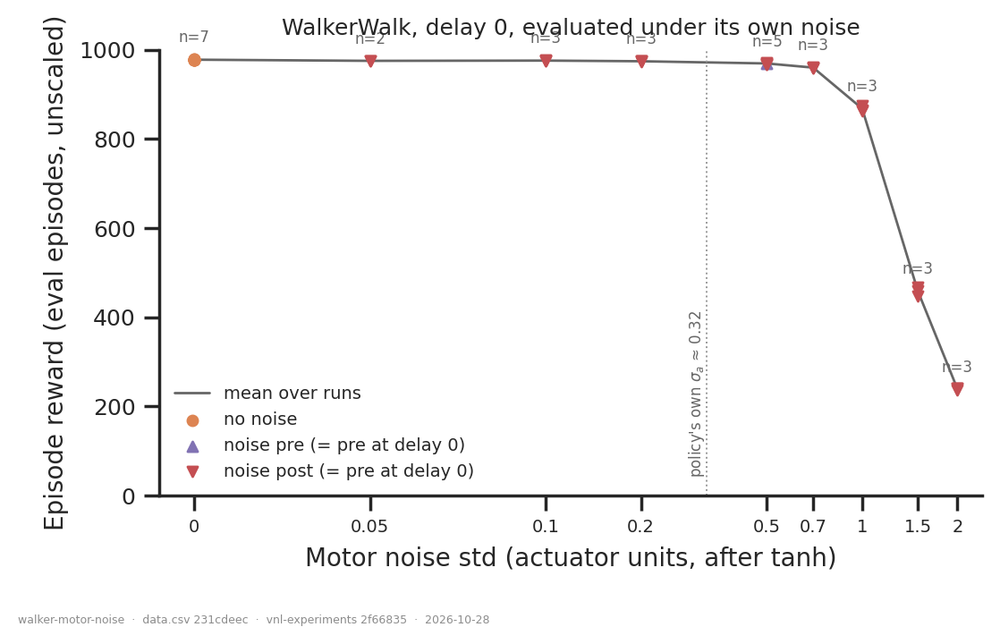
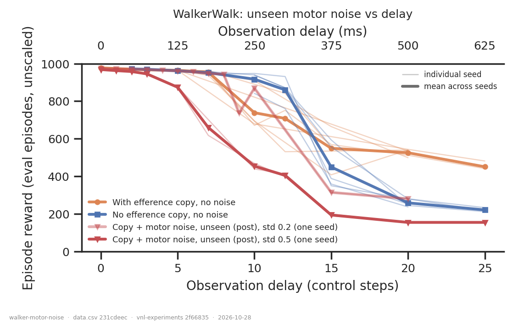
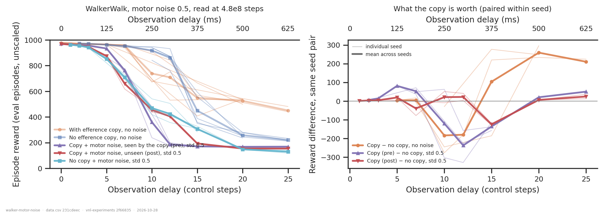
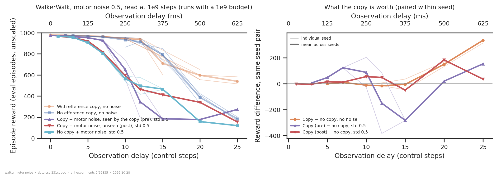
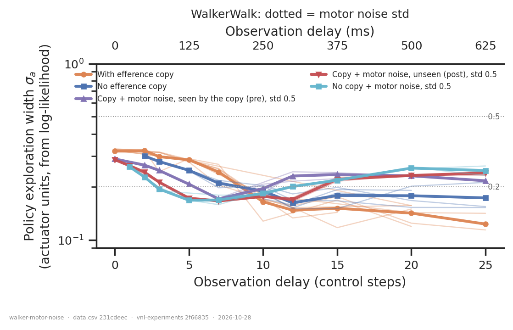
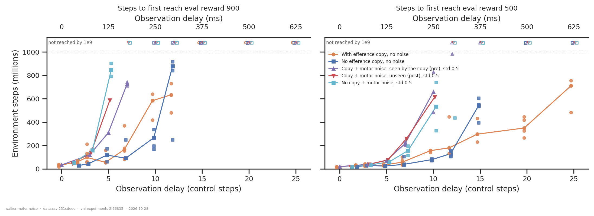
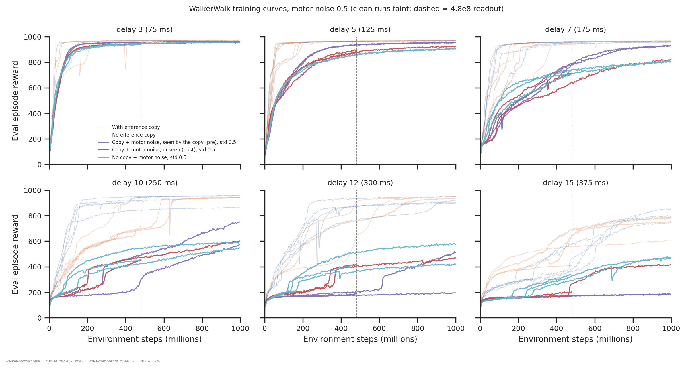

# Motor noise and the efference copy on WalkerWalk

> **Preliminary.** There are three batches of motor-noise runs (2026-10-27 and two on
> 2026-10-28).
> - The three-arm comparison at std 0.5 now has **2–3 seed pairs per cell at d3–d15**
>   (i42 at 4.8e8; i43 and i44 at 1e9), and mostly 1 elsewhere.
> - Seed pairs share initial weights across delays, so neighbouring delays are not
>   independent confirmations.
>
> This folder was renamed from `motor-noise-first-look` on 2026-10-28. CartpoleSwingup is
> in [`../cartpole-motor-noise/`](../cartpole-motor-noise/report.md).

## Question

On dm_control a delayed `DelayedMLP` barely needs its efference copy
([`../efference-copy-across-tasks/`](../efference-copy-across-tasks/report.md)). The
hypothesis is that the tasks are deterministic, so the in-flight actions are predictable
from the delayed observation and tell the policy nothing new. Fixed Gaussian noise on the
executed action (`net.motor_noise_std`, added in `2f66835`) should break that. Three noisy
arms test it:

| arm | config | what the queue holds |
|---|---|---|
| **pre** | `motor_noise_site=pre_efference`, copy on | the noisy action, so it carries information the delayed observation lacks |
| **post** | `motor_noise_site=post_efference`, copy on | the intended action; the noise is unseen |
| **noisy no-copy** | `efference=0` | nothing; the site is moot |

Prediction: copy-on minus no-copy (the copy's *advantage*) grows under noise for **pre**,
and not for **post**.

## Answers up front

| | answer |
|---|---|
| **What does noise cost on its own?** | At d0 (no queue): std ≤ 0.2 costs 2–4 reward, 0.5 costs 9, 0.7 costs 18, 1.0 costs 114, 1.5 costs 514, 2.0 costs 739 (fig. 1). The cliff is between 0.7 and 1.0, about 3× the policy's own exploration width (σₐ ≈ 0.32). |
| **Does delay amplify it?** | Strongly. Unseen noise at 0.5 costs 9 at d0, about 90 at d5 and about 300 at d7, and is near the ~150 floor by d15 (fig. 2). |
| **Unseen (post) noise** | **The copy is worth about nothing, as predicted.** Post minus noisy no-copy (same seed pair) is within ±51 at every delay at 4.8e8, except one d7 seed (−77) and d15 (see the exceptions below). At 1e9 the same holds out to d15. |
| **Seen (pre) noise** | **The copy becomes useful at d5–d7, as predicted, and the gain grows with training.** Pre minus noisy no-copy is +81 / +81 at d5 and +71 / +50 / +37 at d7 at 4.8e8. At 1e9 it is +45 / +50 at d5 and **+123 / +123 at d7**. Paired pre − post at d5–7 is +62 to +128 (3 pairs). The clean copy is worth −8 to +17 at these delays. |
| **Time to solve** | Pre reaches 900 at d5 in **~310M steps** (2 seeds). Post takes 586M and noisy no-copy 792–902M. At d7 only pre reaches 900 within 1e9 (710–744M); post and no-copy never do (fig. 6). |
| **But: pre gets stuck at d12–15** | 3 of the 6 pre runs at d10–15 are still on the ~180 plateau at 1e9. All 9 post and noisy no-copy runs there have escaped it. So the seen noise *helps* where the policy can use it and *hurts* learning where it cannot. |
| **Is 0.5 a good level?** | Yes for d3–d7. From d10 on every noisy arm is far below the clean arms, and the pre trap dominates. |

## Dataset & comparability

- **Source:** `emiwar-team/nnx-ppo-delays`, index synced 2026-10-28. There are **175
  WalkerWalk runs** in [`runs.csv`](runs.csv), all with a readout:

  | arm | runs |
  |---|---|
  | post | 56, at std 0.05–2 |
  | noisy no-copy | 22, at std 0.5 |
  | pre | 19, at std 0.5 |
  | clean copy | 46 |
  | clean no-copy | 32 |

  - Budgets are 4.8e8 or 1e9 for the noisy arms, and up to 4e9 for the clean ones.
  - One clean no-copy run (`j1huu3d3`, d7) crashed at 4.75e8. It has a 4.8e8 readout but
    no 1e9 readout.
- **Gates:**
  - network: `DelayedMLP`, privileged critic, `min_std` 0.001, torque, no distillation;
  - era: post-`d168093`;
  - budget: `total_steps ≥ 4.8e8`.
- **Primary readout:** the mean of the eval points in (4.3e8, 4.8e8] for every run. Because
  nnx-ppo has no learning-rate or entropy schedule, a 1e9 run read at 4.8e8 is a 4.8e8 run,
  so all budgets pool. Eval keeps the motor noise on.
- **Complementary readouts:**
  - `reward_1b`: the same window ending at 1e9, only for runs that reach it;
  - `steps_to_{500,800,900}`: the first eval step at that reward.
- **Policy width σₐ** is `exp(−ll/6 − ½log 2πe)`, computed from `loglikelihood/mean` over
  the readout window.
- **Artifacts:** both history specs are at 175/175 ([`coverage.txt`](coverage.txt)).
  `curves.csv` now runs out to 1e9.
- **Programmatic comparability** ([`comparability.txt`](comparability.txt)): all 22
  invariants are single-valued within every condition.
- **Manual comparability:**
  - All noisy runs are at `2f66835` (nnx-ppo `21d6643`). The baselines are at nnx-ppo
    `1725d20` / `5314279`; that diff adds NaN diagnostics and distillation changes only.
  - Most runs had a dirty working copy (18/19 pre, 44/56 post, 14/22 noisy no-copy), so the
    commit hash does not pin their code exactly.
- **Run-to-run floor:** same config and seed pair on different GPUs differ by 1–4 reward
  near the ceiling, and by 21 at d5 post 0.5 (`5mtpupqn` 867, `h8lrw2fe` 888). Treat
  single-run differences below ~20 as unresolved.

## Figures

All reward axes span 0–1000.



**Figure 1: the noise scale, with no delay.** Up to std 0.2 the reward sits just below the
976–979 range of the noise-free runs. 0.5 and 0.7 are clearly below it, and from 1.0 up
reward collapses. The dotted line is the clean policy's exploration width.



**Figure 2: delay amplifies the noise.**
- Post at 0.2 (faint red, one seed) follows the clean arms out to d8.
- Post at 0.5 leaves them at d5 and is near the floor by d15.



**Figure 3: the three-arm comparison at 4.8e8.**
- **Left panel:** post (red) and noisy no-copy (cyan) lie together. Pre (purple) is above
  them at d3–7 and below them at d10–15.
- **Right panel:** the copy's advantage, paired within seed pair.
  - The clean advantage (orange) is about 0 to d7, negative at d10–12 (the copy arm is
    *slower* there, see figs. 5–6), and +200–300 from d15 on.
  - The pre advantage peaks at d5 (+81) and falls through 0 at d10.



**Figure 4: the same comparison at 1e9**, for runs with a 1e9 budget (noisy seeds i43 and
i44).
- **Clean arms:** the clean copy has caught up with no-copy at d10–12 (943 / 939 against
  932 / 915). The d10–12 deficit at 4.8e8 was therefore speed, not level. From d20 the
  clean copy is worth +130 to +355.
- **Pre:** the advantage at d7 grows to +123 in both seeds. At d10–12 the two seeds split:
  one escapes the plateau (+203, +83), and the other doesn't (−28, −383).
- **Post:** still within ±55 of noisy no-copy to d15. The one outlier is d20 (+182, one
  seed, where the post run escaped the floor late).



**Figure 5: the policy's own exploration width.**
- Std 0.5 is 1.5× σₐ at d0 and about 3× at d7.
- The noisy arms' σₐ *rises* where the run fails to learn (pre at d12–15 sits at 0.23–0.24),
  so a high σₐ here marks a stuck run, not deliberate exploration.



**Figure 6: time to solve**, for runs trained to 1e9, so that all share one horizon.
- **Reaching 900** (left):
  - Pre is about 2× faster than post and about 2.5–3× faster than noisy no-copy at d5
    (310M against 586M and 792–902M).
  - At d7 only pre gets there.
  - Among the clean arms, the copy is *slower* than no-copy at d10–12: 418–640M against
    168–336M at d10.
- **Reaching 500** (right): the noisy arms are close together to d10. The pre trap shows as
  censored markers at d12–15.



**Figure 7: training curves out to 1e9** at std 0.5 (clean runs faint; dashed = the 4.8e8
readout).
- At d5–d7 the pre curves separate from post and no-copy after ~2e8 steps, and keep pulling
  away to 1e9.
- At d10–15 every noisy run starts on the ~180 plateau. Escapes are discrete jumps, and pre
  escapes latest: at d10 both pre runs leave only at ~3–4.8e8, at d12 one leaves at ~6e8
  and one never does, and at d15 neither does.

## Interpretation (hedged)

- **Both predictions hold where the task allows them to.**
  - Unseen noise makes the copy worthless: post ≈ noisy no-copy at every delay out to d15,
    at both budgets.
  - Seen noise makes it useful: pre beats both at d5–7, in every seed pair, at both
    budgets, and learns 2× faster. The advantage appears exactly at delays where the clean
    copy is worth nothing (|Δ| ≤ 17). That fits the hypothesis: on a deterministic task the
    queue carries no information, and once it carries the noise, the policy uses it.
- **The pre trap at d10–15 is a learning problem, not an information one.** All noisy arms
  share the early ~180 plateau. The pre arm is the one that most often fails to leave it.
  - A plausible mechanism is that the queue feeds the actor 0.5-std noise that only becomes
    useful once the policy has learned what to do with it. Early on, that is a large
    distractor input.
  - This would also explain the clean copy's slowness at d10–12. Even the clean queue
    carries the sampler's exploration noise (σₐ ≈ 0.15–0.2).
  - Without more seeds, "stochastic escape, with pre unlucky" is not excluded. But 3 stuck
    of 6 against 0 of 9 is suggestive.
- **Exceptions to post ≈ no-copy:**
  - d7 at 4.8e8, one seed (−77). At 1e9 that seed is at +12.
  - d15 at 4.8e8 (−130 / −120): post was still on the plateau that no-copy had left.
  - d20 at 1e9 (+182): post had left it.

  These are escape timing, not information.

## Recommendations

| axis | values | why |
|---|---|---|
| headline cells | **d5 and d7, std 0.5, pre / post / noisy no-copy, ≥ 3 more seed pairs, 1e9** | This is where the effect lives and still grows at 1e9. d5 post has 1 run at 1e9 and d7 post 1 run; those are the thinnest cells. |
| the trap | **d10–12 pre and noisy no-copy, ≥ 4 seeds** | This tests whether pre gets stuck more often than chance. |
| mechanism (optional) | lower noise at d10–12 (std 0.2–0.3), pre / post / no-copy | If the trap is noise size against what the policy can use, a smaller std should move the pre advantage to longer delays. |
| hygiene | launch from a clean working copy | 18 of 19 pre runs were dirty. |

```bash
sbatch slurm_dmc_requeue.sh env=dmc/walker_walk net=delayed_mlp train=dmc delay=7 \
    net.motor_noise_std=0.5 net.motor_noise_site=pre_efference seed=60 train.seed=60 \
    train.ppo.total_steps=1000000000
# post: net.motor_noise_site=post_efference     no-copy: efference=0
```

## Follow-ups

1. **A checkpoint-level test that needs no new training.** Take a d7 pre checkpoint and
   evaluate it with the queue fed the clean action instead (i.e. run it as post). The drop
   measures how much the policy actually *uses* the noise in the queue. This needs the
   cluster checkpoints and a small eval option.
2. Re-run the d12–15 pre plateau with more seeds before reading anything into it.
3. The other nine dm_control analyses still lack the `no_motor_noise_mask` gate. Add it
   before their next `--refresh`.
