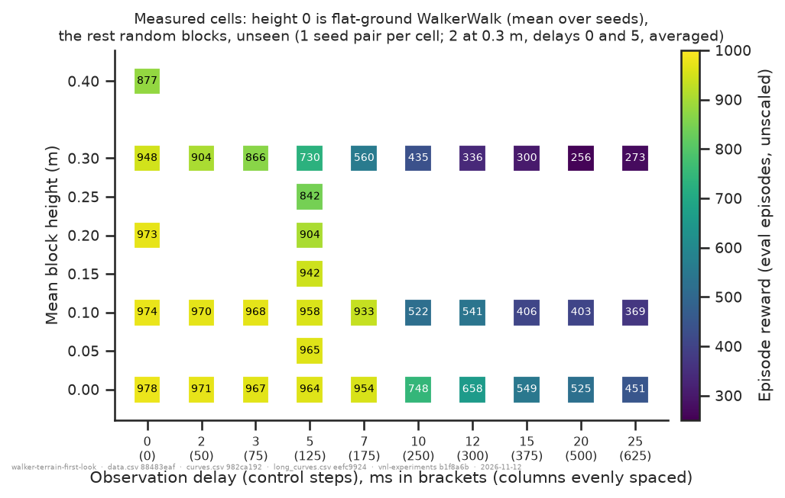
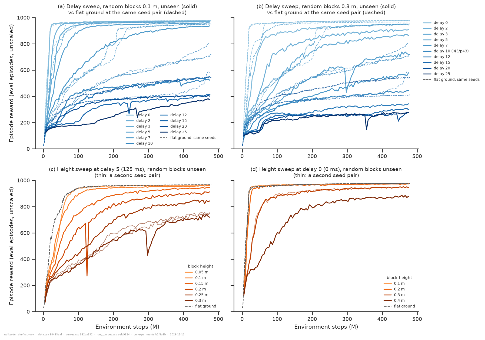
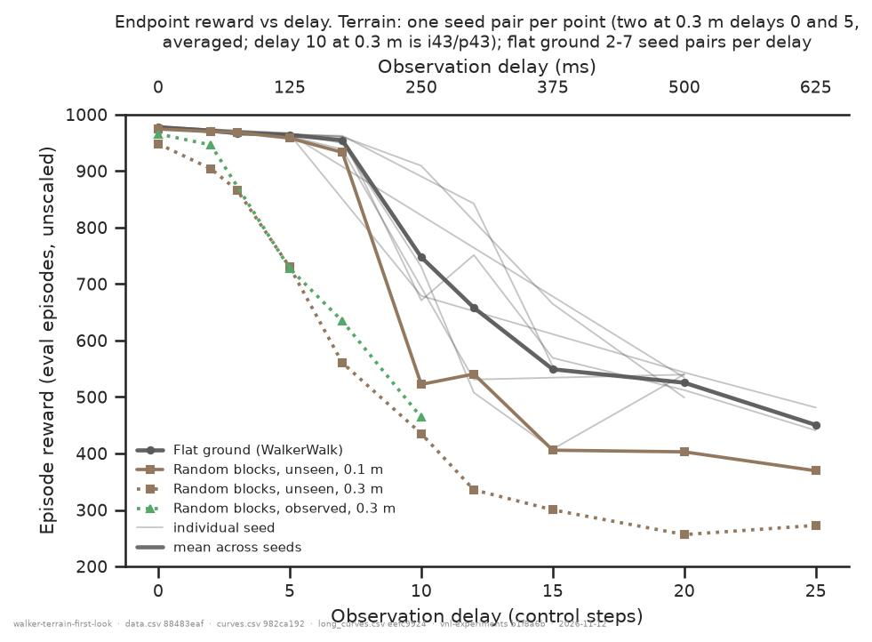
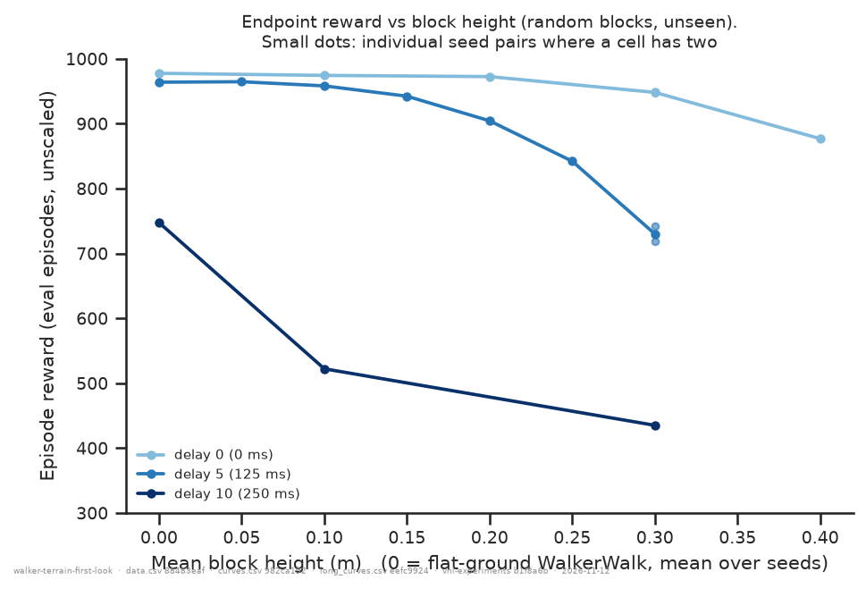
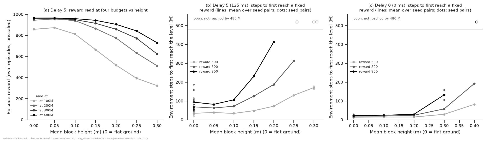
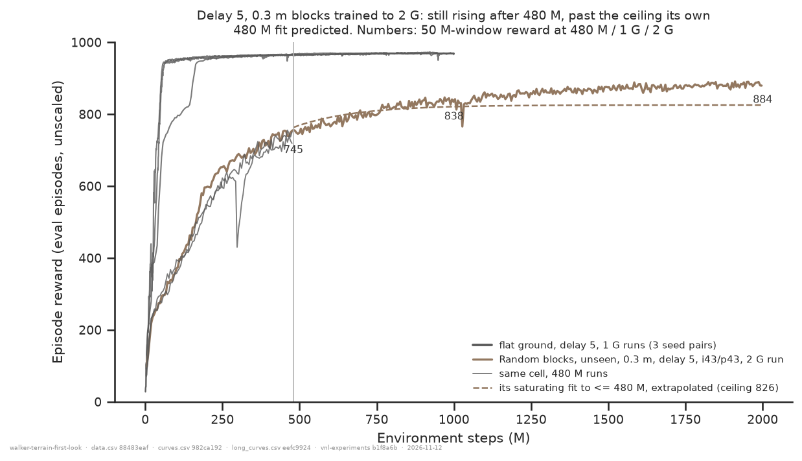
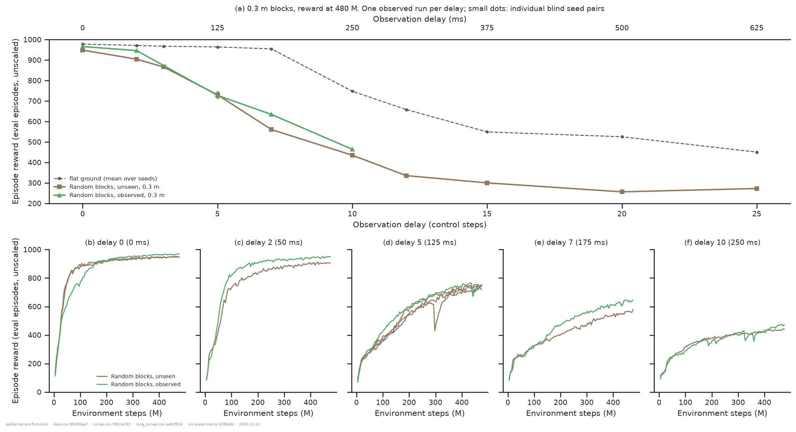
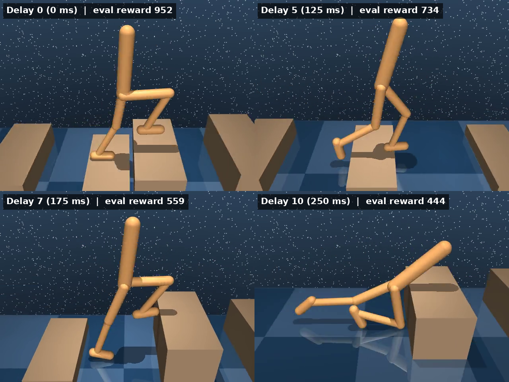

# WalkerWalkTerrain, first look: where is the interesting regime, and is lower reward a plateau or slow learning?

## Question

1. Across the preliminary (delay, block height) sweeps, where does terrain change the
   outcome? The target is a regime that is neither at the flat-ground ceiling nor
   swamped by the delay alone.
2. Where terrain lowers the reward at 480 M steps, is that an **earlier plateau** (a
   lower ceiling, reached about as fast) or **slower learning** (the same ceiling,
   reached later)?
3. Briefly: does seeing the next blocks (`terrain.observed`) help?

*Update 2026-11-12:* added the overnight batch. It contains:
- a blind delay sweep at 0.3 m;
- an observed delay sweep at 0.3 m (delays 2, 7, 10);
- one delay-5 / 0.3 m run trained to 2 G steps;
- 5 Warp flat-ground runs on the same software stack as the terrain runs.

Four runs of that batch crashed (storage failure). They are requeued and not yet
included. `extract.py --refresh` picks them up once they finish.

### How rewards are compared here

The episode reward is bounded: 0 to 1000, with flat-ground walking near 960–980 and
failing walkers near 250–500. It is therefore a saturating, nonlinear readout of
whatever "performance" is underneath.
- A 30-point difference near the ceiling and a 200-point difference mid-range need
  not reflect different underlying effects.
- An interaction read off reward *differences* (e.g. "terrain hurts more at long
  delays") can be produced or erased by the scale alone, unless the curves cross.

So this report shows **only raw rewards** and makes **only ordinal claims**: which of
two conditions is higher, whether a run is still rising, and which reaches a fixed
reward level first. No gaps, differences or "share of gap closed".

The second readout is **steps to first reach a fixed reward** (500 / 800 / 900). Its
ordering survives any monotone rescaling of the score. A level a run never reaches is
shown as "not reached by 480 M", never as a number. `data.csv` still carries
`late_slope`, `fit_rinf` and `backtest_err`, but they are not used for conclusions. The
fitted ceilings proved unreliable (see the 2 G run), and slopes near the ceiling are
bounded by it.

## Dataset & comparability

- **Source:** WandB `emiwar-team/nnx-ppo-delays`, index synced 2026-11-12. Selected by
  the `CONDITIONS` in `extract.py` and frozen in `runs.csv` (88 runs).
- **Conditions** (all `DelayedMLP`, `efference_length == delay`, privileged critic,
  `min_std` 0.001, torque control, no motor noise, trained to budget):

| condition | task | n | seed pairs | delays | heights (m) | commits |
|---|---|---|---|---|---|---|
| `flat_ground` | WalkerWalk | 53 | 11 (3–9 per delay) | 0–25 | 0 | 9, from `971ab99` onwards |
| `terrain_blind` | WalkerWalkTerrain, irregularity 1 | 29 | i42/p1234 (+ i43/p43 for 5 runs) | 0–25 | 0.05–0.4 | `5ec507a` (28), `7b03e9a` (1) |
| `terrain_observed` | as above, `observed=true` | 5 | i42/p1234 | 0, 2, 5, 7, 10 | 0.3 | `5ec507a` |
| `terrain_periodic` | irregularity 0 | 1 | i42/p1234 | 0 | 0.1 | `7b03e9a` |

  The terrain runs are four slices, not a grid:
  - **(a) Delay sweep at 0.1 m:** delays 0, 2, 3, 5, 7, 10, 12, 15, 20, 25.
  - **(b) Delay sweep at 0.3 m:** the same delays. Delay 10 exists only at i43/p43;
    delays 0 and 5 also have i43/p43.
  - **(c) Height sweep at delay 5:** 0.05–0.3 m in 0.05 m steps.
  - **(d) Sparser height sweep at delay 0:** 0.1, 0.2, 0.3 and 0.4 m; 0.4 m is
    i43/p43 only.

  The delay-5 / 0.3 m cell holds three runs: i42/p1234 at 480 M, and two at i43/p43
  (one 480 M run, plus `sog4k5xi` trained to 2 G). Same-seed duplicates are averaged
  within a seed pair before averaging across pairs.
- **Reward reported:** `eval/episode_reward/mean`, unscaled, full-length 1000-step
  eval episodes. Every run is on the post-`971ab99` side of the eval-wrapper fix.
  - Endpoint = mean of the eval points in (430 M, 480 M] (README §6). Runs with
    1–4 G budgets are read there too, which is valid because there is no LR schedule.
    `reward_at_1000M` / `reward_at_2000M` hold the same window at 1 G / 2 G for runs
    that went that far.
  - Eval episodes use the same terrain distribution as training, freshly sampled, so
    this is not held-out.
- **Tasks:** WalkerWalk and WalkerWalkTerrain share plant, reward, `ctrl_dt` (25 ms),
  episode length and reward scale. At `height = 0` the terrain env is WalkerWalk bit
  for bit (`envs/walker_terrain_test.py`).
  - The *attainable* reward on terrain is unknown and probably below flat ground's:
    stepping over blocks may cost speed reward even for a perfect walker. Flat ground
    is therefore a reference line, not the ceiling the terrain runs should reach.
- **Artifacts used:** `REQUIRES = ["index", "history:hist2000-8b97281e"]`, 88/88
  coverage (`coverage.txt`). Every history was produced after its run finished.
- **Programmatic comparability** (`comparability.txt`):
  - Every PPO, network, eval and env-scaling invariant is single-valued across all
    four conditions.
  - So are the terrain geometry keys other than the swept ones (gap 1 m, block length
    0.25 m, 12 blocks, …) and `naconmax` / `njmax`.
  - Only the design axes vary.
- **Manual comparability:**
  - I read the configs, tags and notes. The notes ("Sweeping block height",
    "Observable terrain", "Terrain longer training") match the logged `env_params`.
  - The two terrain commits differ only in `requeue.py` and `train.py`'s WandB run-id
    helper. That touches no training, env, network or reward code.
  - The 5 new flat runs are tagged `requeue` with the note "Trying MuJoCo 4.0 with
    requeue". They run on the same stack as every terrain run: Warp backend,
    `nnx_ppo` `21d6643`, playground `293156c`, and the same commit `5ec507a`. The
    MuJoCo version itself is not logged.
- **Caveats:**
  - **Almost every terrain cell has a single seed pair.** Two seed pairs exist only at
    0.3 m (delays 0 and 5), and there they agree closely (948 / 949; 718 / 742).
    - The flat-ground seed range is narrow up to delay 7 and at delays 20–25.
    - It is wide on the cliff at delays 10–15 (e.g. 671–909 at delay 10).
  - **23 of the 33 `5ec507a` terrain runs were launched from a dirty working copy**
    (`repos.vnl_experiments.dirty`). 8 of the 11 new runs are clean. The local tree's
    `envs/` matches the commit, and the logged `env_params` are the authoritative
    record of what ran (README §6).
  - **Backend mix:** every terrain run is Warp. Flat ground is 46 MJX-JAX and 7 Warp,
    the Warp runs at delays 0, 2, 5 (×2), 7, 10 and 12.
    - Where a Warp run has a JAX twin at the same seed pair, they read 978 / 977
      (delay 0) and 949 / 950 (delay 7).
    - At delay 10 the twins read 767 / 695, both inside that delay's seed range.
    - The other Warp flat runs fall inside the JAX seed range.
  - Flat-ground eval cadence is mixed (600 k and 4.8 M). That changes how many points
    fall in a window and the resolution of steps-to-level, not the values.
  - Terrain runs are **seed-paired** with the flat i42/p1234 runs. The same seed
    shares the initial weights across delays (project note), so each delay sweep is
    close to one replicate traced through delay.
  - **The long-budget evidence is one run.**

## Figures

Every measured (delay, height) cell, coloured and labelled by raw endpoint reward;
columns are evenly spaced, not to scale.
- **Height 0 row (flat ground):** at ceiling through delay 7, then the delay cliff.
- **0.1 m row:** at ceiling through delay 5 as well.
- **0.3 m row:** below its flat-ground cell at every delay.

**(a) Delay sweep at 0.1 m**, against flat-ground runs at the same seed pair (dashed).
At delays ≤ 5 the solid and dashed curves nearly coincide.

**(b) Delay sweep at 0.3 m.** At every delay the solid curve lies below its flat twin
for most of training. Delays 12–25 bunch together near 250–350.

**(c) Delay 5, height sweep.**
- Each 0.05 m of height pushes the whole curve down and right, already in the first
  50 M steps.
- The three 0.3 m runs (two seed pairs) agree closely.
- Transient collapses appear around 120 M and 300 M.

**(d) Delay 0, height sweep.** Up to 0.2 m the curves are indistinguishable from flat
ground, but the readout is at its ceiling there. At 0.3 m they flatten early at a
lower level. The 0.4 m curve is slow and still climbing.

Raw endpoint reward against delay, with flat ground drawn as mean plus each seed pair.

**0.3 m blind:** below **every** flat-ground seed pair at **every** delay. That ordering
holds under any rescaling of the score. Readings at delays 0–25:

| delay | 0 | 2 | 3 | 5 | 7 | 10 | 12 | 15 | 20 | 25 |
|---|---|---|---|---|---|---|---|---|---|---|
| 0.3 m blind | 948 | 904 | 866 | 730 | 560 | 435 | 336 | 300 | 256 | 273 |
| flat ground, lowest seed | 976 | 968 | 963 | 956 | 939 | 671 | 508 | 408 | 499 | 429 |

**0.1 m blind:** inside the flat-ground seed range at delays 2, 3, 5 and 12; below it
at delays 7, 10, 20 and 25; at its edge at 0 and 15. That is with one terrain run per
delay.

Raw endpoint reward against height at delays 0, 5 and 10.
- **Delay 0:** the reading stays at the ceiling to 0.2 m, then falls at 0.3–0.4 m.
- **Delay 5:** it falls from 0.15 m on.
- **Delay 10:** walking has already collapsed on flat ground, and the two single runs
  sit lower still.

Whether delay 0 is "unaffected" by small blocks, or just at the top of the scale,
cannot be told from this readout.

**(a) Delay 5, raw reward read at 100 / 200 / 300 / 480 M against height.** At every
height above 0.1 m the reading keeps rising across the four budgets.

**(b, c) Steps to first reach reward 500 / 800 / 900.** Lines are the mean over seed
pairs, dots individual seed pairs, open circles "not reached by 480 M".
- **Delay 5:**
  - Flat-ground seed pairs reach 900 at 52–187 M.
  - The 0.05 and 0.1 m runs fall inside that range (82 M, 106 M).
  - 0.15 m reaches 900 at 231 M, and 0.2 m at 413 M.
  - 0.25 m reaches 800 at 312 M but never 900. At 0.3 m the runs reach 500 at
    163–178 M and never reach 800 by 480 M.
- **Delay 0:**
  - Flat ground and heights ≤ 0.2 m all reach 900 within 19–29 M.
  - 0.3 m reaches it at 106–159 M.
  - 0.4 m reaches 800 at 192 M but never 900.

**The direct test.** Delay 5, 0.3 m, i43/p43, trained to 2 G steps, against three
flat-ground delay-5 runs trained to 1 G and the same cell's 480 M runs.
- It reads 745 at 480 M (its same-seed 480 M twin: 739), 838 at 1 G and 884 at 2 G.
- The rise slows: 8 reward per 100 M over 1–1.5 G, 2.4 per 100 M over 1.5–2 G.
- The saturating fit to its first 480 M predicted it would level off at 826. It passed
  that within ~300 M further steps.
- Flat-ground delay-5 runs read 969 at 1 G.

**(a) 0.3 m blocks**, raw reward at 480 M, one observed run per delay:

| delay | 0 | 2 | 5 | 7 | 10 |
|---|---|---|---|---|---|
| observed | 966 | 946 | 727 | 634 | 464 |
| blind | 948 / 949 | 904 | 718 / 742 | 560 | 435 (other seed pair) |

**(b–f) Curves.**
- **Delay 0:** the observed run is slower at first (it reaches 800 at 111 M, against
  the blind runs' 58 M). It ends higher.
- **Delays 2 and 7:** the observed run is ahead from ~50–150 M onwards. At delay 2 it
  reaches 900 at 168 M, against 375 M blind.
- **Delay 5:** it leads mid-training and ends between the two blind seed pairs.
- **Delay 10:** the two are indistinguishable until ~400 M.

### Video: what the rewards look like

`eval_videos/collage_2x2_walker_terrain_h0.3.mp4` (gitignored; rebuild with
`make_video.py`). It shows blind random blocks at 0.3 m, delays 0 / 5 / 7 / 10, real time
(40 fps, 25 s).
- **Source:** each tile is the run's last eval video logged to WandB (step 480 M).
- **Seeds:** the runs are on seed pair i42/p1234, except delay 10, which exists only at
  i43/p43.
- **Labels:** each carries the run's **final eval reward** (its last eval point, at
  480.2 M). That is a mean over eval episodes, close to the 430–480 M endpoint used
  above; `video_audit.txt` lists both.

The still is frame 480 (12 s). This is an illustration, not a measurement. Each tile is
one episode, separate from the eval episodes behind its number, so a tile can look better
or worse than its label.

## Tentative conclusion

**Interesting regime.** What the bounded score can show is where terrain moves the
reading *off its ceiling* without pushing it onto the delay floor.
- **Ceiling, so terrain effects are not measurable with this score:**
  - delay 0 with blocks up to 0.2 m;
  - delays up to 5 with 0.1 m blocks.
  An effect there may exist, but the endpoint cannot show it. Time-to-900 does not
  separate them from flat ground either.
- **Off the ceiling and above the floor:**
  - delays 2–7 at 0.15–0.3 m;
  - delay 0 at 0.3–0.4 m.

  Here the terrain run is below every flat-ground seed, and both endpoint and
  time-to-level separate conditions.
- **Floor-bound:** delays 10–25 at 0.3 m read 250–440. That is below every flat seed,
  but in the range where flat ground itself is failing. A lower reading there is not
  interpretable as a larger effect.

The working window is therefore **delays 2–7 × heights 0.15–0.3 m**, with delay 0 at
0.3–0.4 m as the "terrain alone" control. I am not claiming an interaction between
delay and terrain. The curves never cross, so whether terrain "matters more" at longer
delays depends on the scale it is read on.

**Plateau vs slow learning.** At delay 5 / 0.3 m, **largely slow learning**, as far as
one long run shows.
- The run keeps rising long after 480 M (745 → 838 → 884). Within the height sweep,
  the time to reach any fixed level grows steadily with height.
- By 2 G it is flattening at 884, below the 969 that flat-ground runs reach at that
  delay.
- Whether 884 is a lower ceiling *for the learner* or *for the task* is open. Blocks
  may cap the attainable reward below flat ground's, and nothing here measures that
  cap.
- Extrapolating from ≤ 480 M is not reliable: the fit undershot by a wide margin.

At delay 0 / 0.3 m both seed pairs level off by ~150 M at 948–949, below every
flat-ground seed. It is the same open question at a smaller scale: lower learner
ceiling, or lower task ceiling.

**Observed vs blind.** With one observed run per delay, still a hint.
- The observed run ends **above** the blind one at delays 0, 2, 7 and 10, and between
  the two blind seed pairs at delay 5.
- At delays 2 and 7 it gets ahead early and stays ahead.
- At delay 0 it starts slower and ends higher.

## Follow-ups

- **The requeued four runs:** re-run `extract.py --refresh` when they finish, then
  `plot.py`.
- **A non-saturating readout.** Measure mean forward speed and falls per episode from
  eval rollouts. These would let effect *sizes* be compared across delays and heights,
  which the bounded reward does not allow. The same rollouts would also give a
  task-ceiling reference for terrain (e.g. the best speed achieved over blocks).
- **Replicate the working window.** Delays {2, 3, 5, 7} × heights {0.15, 0.2, 0.3} × 3
  seed pairs, passing `seed=N train.seed=N`.
- **More long runs.** A second seed pair at delay 5 / 0.3 m to 2 G. Also delay 0 at 0.3
  / 0.4 m, delay 7 at 0.3 m, and one 2 G flat-ground delay-5 run on the Warp stack as
  the matched reference.
- **Observed vs blind with seeds,** at delays 2 and 7, where the single runs separate
  most clearly.
- **Periodic vs random** at a height off the ceiling (0.3 m, delays 2–7). The single
  periodic run is at 0.1 m / delay 0, where both read at ceiling (976 vs 974), so it
  says nothing about unpredictability yet.
- **The transient collapses** in the delay-5 / 0.3 m curves (one or two eval points
  dropping 200–400; one also at ~1 G in the 2 G run) could be eval noise from a rare
  hard layout, or policy instability. Worth a look before the sweep grows.

---

*Reproduce:* `../.venv/bin/python analysis/dm_control_suite/walker-terrain-first-look/extract.py && ../.venv/bin/python analysis/dm_control_suite/walker-terrain-first-look/plot.py`
(add `--refresh` to the extract to pull runs added to the index since `runs.csv` was
frozen, and `--sync` to also sync the index first).
