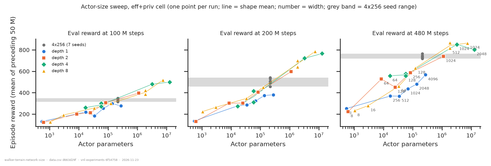
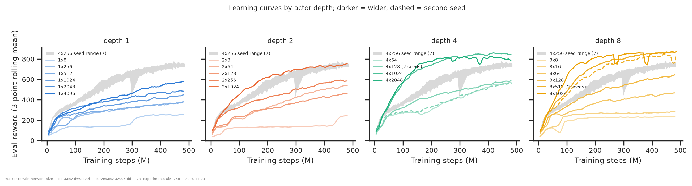
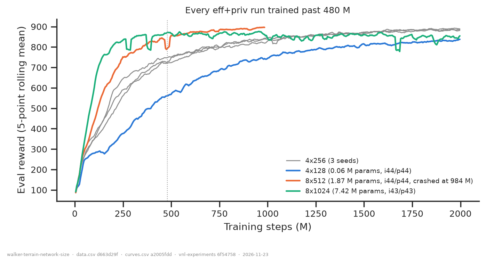
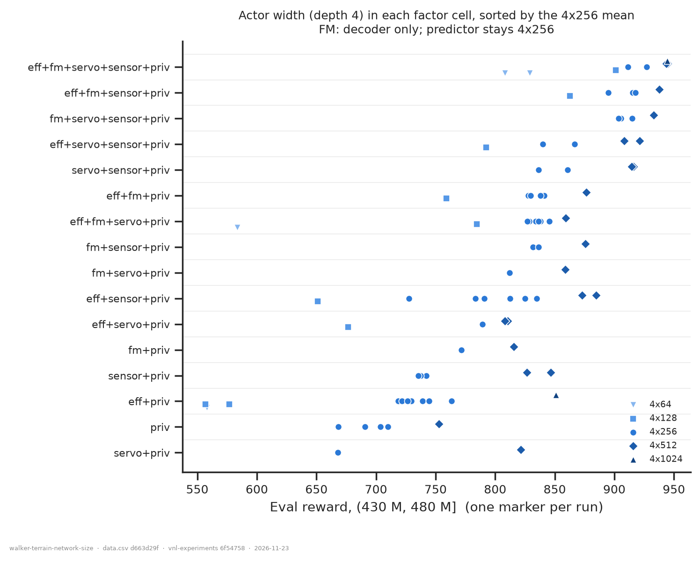

# WalkerWalkTerrain: does actor size matter, and is it width or depth? (preliminary)

## Question

On WalkerWalkTerrain (0.3 m irregular blocks, delay 5 = 125 ms, 480 M steps):

1. Does the size of the actor network matter?
2. If it does, is the effect on learning speed, on eventual performance, or both?
3. Is parameter count what matters, or does shape (wide versus deep) matter too?

This is a preliminary analysis. Where the data cannot answer a question, the report
says so instead of extrapolating.

*Update 2026-11-23:* the index was re-synced and three new batches were added (49 runs
in total).
- **"Smaller network longer train"**: second seeds at a 2 G budget for 4×128, 4×1024,
  8×512, and a new shape, 8×1024. Several of these crashed early (see Caveats).
- **"Sweeping factors for larger / even larger network"**: 4×512 in 15 of the 16
  privileged-critic factor cells, plus one FM 4×1024.
- **"Even smaller network"**: FM 4×64 in two cells.

Because of these batches, the factor cohort now covers **every** privileged-critic
cell, including the efference-0 cells. Their 4×256 baselines come from
walker-terrain-factors. Unprivileged-critic cells got no size runs and are not
selected.

## Dataset & comparability

- **Source:** WandB `emiwar-team/nnx-ppo-delays`, index synced 2026-11-23. Selected by
  the `CONDITIONS` in `extract.py` and frozen in `runs.csv` (116 runs, 107 of them
  reaching 480 M).
- **What varies:** only the **actor** MLP's hidden shape (depth × width). All layers
  in a net have the same width. The critic is 5×256 in every run, so "network size"
  here always means actor size.
- **Setup:** the same as `walker-terrain-factors`, with every non-factor setting held
  constant.
- **Conditions:** each condition is a `<factor cell>|<depth>x<width>` pair.

| cohort | cells | shapes | runs per shape | seed pairs | commit |
|---|---|---|---|---|---|
| `sweep` | `eff+priv` (DelayedMLP, efference 5, blind, no servo, privileged critic) | 21 shapes: depth 1, 2, 4, 8; widths 8–4096 | 1, except 4×128 (2), 8×512 (2), 8×1024 (1 + 1 crashed), 4×1024 (1 + 2 crashed) | mostly i42/p1234; i43/p43 and i44/p44 for some | `2dbee47` |
| `sweep` (baseline) | `eff+priv` | 4×256 | 7 | i42/p1234, i43/p43 ×2, i44–i47 | `5ec507a` (6), `03f6cc5` (1) |
| `factors` | the other 15 privileged-critic cells (DelayedMLP / FM × efference 0/5 × sensor × servo) | depth 4: widths 64 (FM, 2 cells), 128 (7 cells), 512 (15 cells), 1024 (1 FM cell) | 1–2 | i42/p1234, i43/p43 | `2dbee47` |
| `factors` (baseline) | same 15 cells | 4×256 | 1–7 per cell | i42–i48 | `5ec507a`, `03f6cc5` |

- **Parameter counts:** `actor_params` is computed by `extract.py`, because current
  runs do not log it.
  - The formula reproduces the legacy WalkerWalk runs' logged `n_actor_params`
    exactly.
  - It ranges from 548 (1×8) to 12.7 M (4×2048). The default 4×256 has 215 k.
  - For FM runs it counts the decoder only. `extract.py` stops unless every FM
    predictor is 4×256.
- **Reward reported:** `eval/episode_reward/mean`, unscaled, from full-length eval
  episodes. All runs are after the eval fix at `971ab99`.
  - Readouts are 50 M window means ending at 100 M, 200 M, 480 M, 1 G and 2 G. A
    window counts only if the run's history reaches its end, within one eval interval.
    (Before this update, an early-crashed run could report a "100 M" value from a
    partial window. No completed run was affected.)
  - Eval episodes come from the training distribution, so this is not held-out
    performance.
- **Artifacts:** `history:hist2000-8b97281e`, 116/116 covered (`coverage.txt`).
  - 32 histories were produced in this update.
  - I checked every history's `resolved.max_step` against the run's final step. None
    is a stale snapshot. The two found last time were re-produced then.
- **Programmatic comparability** (`comparability.txt`):
  - `extract.py` stops unless every PPO, eval, critic, env, terrain, backend
    (`impl = warp`), `nnx_ppo` and playground setting is single-valued across all
    116 runs. That check passes.
  - Only the design axes vary.
- **Manual comparability:**
  - The notes of the new batches name what they sweep, and they match the logged
    `net_params` / `env_params`.
  - The new runs are all on `2dbee47`, so no new commit was added. The earlier
    verdict stands: `5ec507a` → `2dbee47` touches only `artifacts/`, `style.py` and
    one `wandb.teardown()` in `requeue.py`.
- **Caveats:**
  - **Replication is still thin.** Most sweep shapes have one run, and most factor
    cells have one or two runs per width. The best seed-spread estimate is still
    4×256 in `eff+priv`: 718–764 at 480 M (7 runs). The two-seed shapes differ by
    20 (4×128) and 50 (8×512).
  - **Crashed runs.** Several of the new long runs crashed:
    - 4×1024 at 62 M and 72 M, and 8×1024 (i44) at 91 M. These have no readouts.
    - 8×512 (i44) at 984 M. Its 480 M readout is valid, but it has no 1 G readout.
    - 1×1024 (i44) never logged a step and is not selected.

    Their notes show requeue attempts, so some may yet resume. If they do, re-produce
    their histories with `artifacts ensure ... --override` (README trap: a history of
    a running run is a frozen snapshot).
  - Six older 4×256 factor-cell runs also crashed before 480 M. They stay in with
    `complete=False`.
  - 77/116 runs were launched from a dirty working copy, so the logged config is the
    record of what ran.
  - GPUs are mixed (8 models). 31 runs were preempted and resumed.
  - The PPO hyperparameters were tuned at 4×256 and are identical everywhere. Size
    effects may partly be learning-rate effects. This matters most for the
    2 G-budget question below.
  - The score is bounded (README trap). Per-cell gains from widening shrink toward
    the ceiling, so the claims below are ordinal only.

## Figures

Reward at 100 M, 200 M and 480 M against actor parameters. There is one point per run,
the line joins shape means, and the grey band is the 4×256 seed range.
- At every budget, reward rises with parameter count over about four decades.
- Depth 1 (blue) falls below the deeper nets from about 200 M onwards.

Learning curves up to 480 M, one panel per depth. Darker means wider, and dashed lines
are second seeds.
- Width-8 nets stall at about 130–250 at every depth.
- The ≥ 1.8 M-parameter nets rise above the band early, and both seeds of 8×512 do.
- The two 4×128 seeds lie on top of each other, well below the band.

**The figure to look at for question 2.** It shows every `eff+priv` run trained past
480 M.
- The 4×256 runs reach 882–890 at 2 G.
- 4×128 lags 4×256 at every budget and ends at 834.
- 8×512 (i44) reaches 4×256's 2 G level by about 700–800 M, then crashes.
- 8×1024 jumps ahead early, flattens at about 850–865 from 400 M onwards, and ends
  below 4×256 at 2 G. It shows several brief collapses along the way.

Depth-4 actors of width 64–1024 (one marker per run) in each privileged-critic cell,
sorted by the cell's 4×256 mean. Within each row, the markers order by width almost
without overlap.

## Tentative conclusion

**1. Does size matter? Yes. The evidence is now strong for the depth-4 width step and
consistent elsewhere.**
- **Factor cells.** Across every privileged-critic cell:
  - 4×512 beats **every** 4×256 run of the same cell in **all 15** cells that have
    both, by margins of 14–154 points.
  - 4×128 is below every 4×256 run in **all 8** cells that have both.
  - FM 4×64 is below 4×128 where both exist.
  - The two-seed 4×512 cells agree within 1–20 points.
- **Main sweep.** Every shape under about 130 k parameters scores below all seven
  4×256 seeds at 480 M. That now includes both 4×128 seeds (577, 557). All four
  shapes above 1.8 M parameters, and both 8×512 seeds (866, 816), score above them.
  Every shape other than 4×256 has one or two seeds.
- **Ranking of factor cells.** Size mostly leaves it unchanged: Spearman ρ between
  cell means is 0.91 for 4×256 vs 4×512 (15 cells) and 0.95 for 4×128 vs 4×256
  (8 cells).
  - One ordinal flip is worth checking before it is believed. Efference copy helps a
    lot in the servo cell at 4×256 (`eff+servo` 789 vs `servo` 668). At 4×512 it does
    not (808/811 vs 822). The two 4×256 numbers are single runs.

**2. Speed or eventual performance? Speed, clearly. There is still no evidence that a
bigger actor raises eventual performance, and one hint that a very large one may
not.**
- **Speed.** The large actors reach 600 / 700 / 800 at:
  - about 90–155 M (600), 120–210 M (700) and 180–350 M (800);
  - against 216–274 M and 312–422 M for 4×256 to reach 600 and 700. 4×256 does not
    reach 800 within 480 M; the 2 G runs reach it at 650–700 M.
- **Small actor, long budget.** 4×128 trained to 2 G (one seed) is below 4×256 at
  every budget: 744 vs 825–841 at 1 G, and 834 vs 882–890 at 2 G.
  - It is still rising slowly, so its ceiling is unknown.
  - Within 2 G, smaller is both slower and lower.
- **Large actors, long budget.** Two runs only:
  - **8×1024** (7.4 M parameters, one seed) reaches 864 at 480 M, then stays there.
    It reads 858 at 1 G and 849 at 2 G, so 4×256 overtakes it at about 1.2–1.5 G
    and ends 30–40 points higher. It also has repeated transient collapses that the
    4×256 runs do not show.
  - **8×512** (i44, 1.9 M) reaches about 883–893 between 700 M and 984 M, which is
    4×256's 2 G level in under half the steps. It crashed before reaching a 1 G readout.
- So nothing here shows a large actor ending *above* 4×256. One run plateaued below
  it, and the other reached the same level faster and then stopped existing.
- The data can't yet separate three possibilities:
  - "bigger = faster to a shared ceiling";
  - "very large actors plateau lower";
  - "very large actors are unstable at this learning rate".

  The crashed 4×1024 / 8×1024 / 8×512 long runs are exactly the ones that would
  decide it.

**3. Parameter count or shape? Unchanged: depth 1 is clearly worse; among depths 2, 4
and 8 the data cannot tell.**
- **Depth 1 versus deeper.** Each single-layer net is 90–200 points below a deeper
  net of similar or fewer parameters at 480 M. All five such matched pairs agree:

  | single layer (params, reward) | deeper net (params, reward) |
  |---|---|
  | 1×256 (17 k, 369) | 4×64 (17 k, 558) |
  | 1×512 (34 k, 368) | 8×64 (33 k, 461) |
  | 1×1024 (69 k, 436) | 4×128 (58 k, 557/577) |
  | 1×2048 (137 k, 481) | 8×128 (124 k, 631) |
  | 1×4096 (274 k, 567) | 4×256 (215 k, 718–764) |

  The gap opens only after about 100–200 M.
- **Depths 2, 4 and 8.** At matched parameters the points lie on one rising trend,
  with differences about seed-noise size.
  - The new 8×1024 (7.4 M, 864) sits with 4×1024 (3.2 M, 851) and 4×2048
    (12.7 M, 802).
  - The second 8×512 seed (816) is a reminder that one-seed differences of 50 points
    among the large nets are within seed spread.
- No new runs were matched for parameter count across depths, so this part of the
  question has not moved.

## Follow-ups

1. **Finish the crashed long runs.** These are 4×1024 (i43, i44), 8×1024 (i44) and
   8×512 (i44), all at 2 G budget. They decide question 2. Once they finish,
   re-produce their histories with `--override` and re-run `extract.py`.
   - If 8×1024's plateau below 4×256 replicates, that is the first real evidence
     that a much larger actor ends lower, rather than only getting there sooner.
   - A 4×512 2 G run would show where the size curve turns.
2. **Stability of the largest actors.** 8×1024 (and 4×1024 at 480 M) show transient
   collapses. A 0.5× learning-rate run at 8×1024 would show whether the plateau is
   a learning-rate artefact.
3. **Shape at fixed parameter count.** Unchanged: an iso-parameter set at about
   200 k and about 1 M (for example 2×~700 / 4×~500 / 8×~350), 3 seeds each.
4. **`eff+priv` at 4×512** is the one privileged cell without a 4×512 run. It is
   also the sweep's own cell, so adding it ties the two cohorts together.
5. **The efference × size flip** in the servo cells. A second 4×256 seed of `servo+priv`
   and `eff+servo+priv` would settle whether the flip is real.
6. **Critic size.** Every run here has a 5×256 critic. One large-actor run with a
   matching critic would test whether the critic limits the large actors.
7. **Pipeline note.** `walker-terrain-factors/extract.py` still does not filter on
   `actor_hidden_sizes`. Its next `--refresh` would pull in all of these size runs
   and then stop on its invariant check. Pin `[256, 256, 256, 256]` in its `_grid`
   first.

---

*Reproduce:* `../.venv/bin/python analysis/dm_control_suite/walker-terrain-network-size/extract.py && ../.venv/bin/python analysis/dm_control_suite/walker-terrain-network-size/plot.py`
(add `--sync --refresh` to the extract to include runs added since `runs.csv` was frozen).
