# What strategies do the walker-terrain-factors networks learn?

## Question

The five factors of [`walker-terrain-factors`](../walker-terrain-factors/) (efference
copy, explicit forward model, block sensor, privileged critic, servo actuators) each raise
eval reward. The rise is smooth, with no step changes. Do the conditions nonetheless
differ *qualitatively*? Specifically:

1. Behaviourally, are the gaits different?
2. Are there interpretable differences in the learned weights?
3. Do networks without a forward model learn an implicit one?
4. Can the factors be inferred from weights alone, especially for two same-architecture
   runs with similar reward?
5. What else can be said about each network's strategy?

This is an exploratory analysis. Each answer below is a description of 62 runs, not a
tested hypothesis.

## Dataset & comparability

- **Runs:** the 62 `complete` runs of
  [`walker-terrain-factors/data.csv`](../walker-terrain-factors/data.csv). Selection,
  factor definitions, invariants and comparability are all documented there. Settings:
  `WalkerWalkTerrain`, 0.3 m irregular blocks, delay 5 (125 ms), 24 cells. All runs are
  read at the **480 215 040 checkpoint**, including the five 2 G runs.
- **Artifacts:** `weights:w-s0480215040-70e4fc12` and three `activations_dmc` recordings
  per run at the same step: `flat`, `h0.3_irr1`, `stairs_h0.3`. Each recording is
  3 deterministic 1000-step episodes on fixed courses, so every run walks the same
  ground. Coverage is 62/62 for both. The eight runs that never reached 480 M have
  neither artifact and are excluded, exactly as in `walker-terrain-factors`.
- **Pipeline exception:** As agreed for this exploratory question, there is no
  `extract.py`, `runs.csv` or `comparability.txt` here. The scripts `gait.py`,
  `gait_cycle.py`, `attribution.py`, `probe.py` and `weights.py` play the extract role:
  they read the store and write the CSVs. `plot.py` reads only those CSVs.
- **Checks** (`check_forward.py`, written to `checks.txt`):
  - The numpy forward pass in `common.py` reproduces every recorded actor-pathway layer
    of all 10 architecture layouts to float16 precision (≤ 0.9 % relative). The
    efference queue rebuilt from recorded actions (newest first) is therefore correct,
    as is the delay.
  - Each run's initial weights are rebuilt with `build_network(..., nnx.Rngs(seed))`,
    as `train.py` does. Trained hidden layers have cosine 0.86–0.89 with their own
    rebuilt init and about 0 with another seed's init.
  - Actor layers 1–4 start bit-identical across all 393 same-seed pairs, FM decoder
    included. Hidden units are therefore aligned within a seed. This is the
    [seed-shared-init](../ball-in-cup-first-look/) effect, used here as a tool.
- **Caveats:**
  - 24 unbalanced cells, seven with a single run.
  - Five init seeds shared across conditions, so seed, not run, is the unit of
    replication.
  - The design is nested: a forward model always has a privileged critic, and a delayed
    critic exists only in MLP+efference runs.
  - Every regression below is a main-effects OLS over runs, with seed not modelled.
    Treat its t-values as effect-size rankings, not p-values.
  - Behaviour comes from 9 episodes per run.
  - Reward is the unscaled eval reward. `reward_480M` is the 430–480 M WandB eval mean
    (`walker-terrain-factors`). `return` in `gait.csv` is the recordings' own per-episode
    return.

## Summary

| question | answer |
|---|---|
| Different gaits? | **Servo vs torque, yes.** Other factors shift particular gait features but leave the overall stride no more different than two seeds of one condition. |
| Interpretable weight differences? | **Yes, mostly in the first layer and the output head.** The forward model's predictor weights past actions the way the actuator physics requires. |
| Implicit forward model? | **No.** No DelayedMLP layer decodes the current state better than the same layer at initialisation, or better than a random nonlinear expansion of its input. The explicit FM does. |
| Factors from weights? | **Servo: always (6/6 same-seed, matched-reward pairs).** The others only within a network type, and much of their pooled signal is reward. |
| Strategy? | Blind nets step high everywhere; sensor nets scale step height to the block ahead. Efference nets are high-gain and jerky. FM nets are smoother and more regular. Servo nets give up velocity feedback for the block sensor. |

## 1. Behaviour: are the gaits different?

All 62 walkers use the same basic gait: a high-knee, alternating bound at 1.3–1.9 m/s on
flat ground. Mean swing-foot peak is 0.4–0.8 m. On the flat course both feet are off
the ground 17–43 % of the time. Left/right phase is ≈ 0.5 in every run.

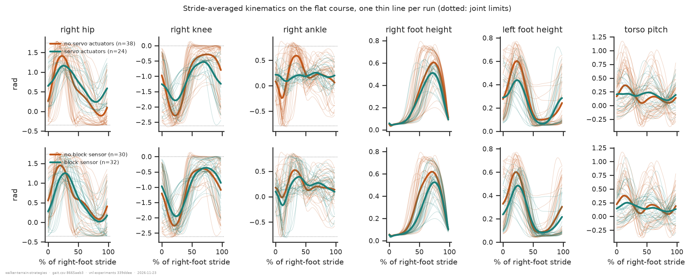

Stride-averaged kinematics on the flat course, one thin line per run. **Top row:** torque
nets (orange) drive the hip and ankle into their joint limits every stride (dotted
lines), using the joint stops as end-points. Servo nets (teal) stay inside the range,
take a smaller hip arc, and leave the ankle almost still. **Bottom row:** blind nets lift
the swing foot higher on ground that has no blocks.

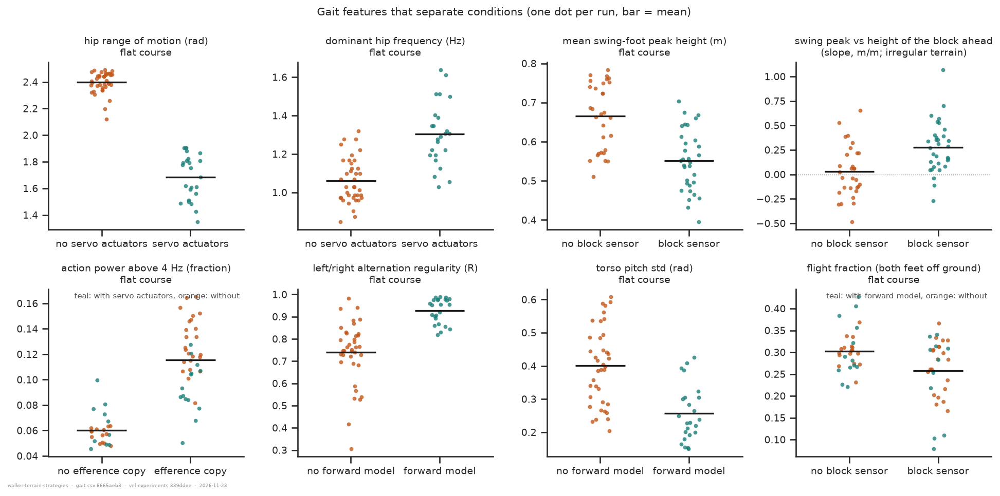

One dot per run.

- **Servo** is the one qualitative split in gait:
  - Hip range of motion 1.69 ± 0.17 vs 2.40 ± 0.08 rad, with no overlap.
  - Higher stepping frequency, 1.31 vs 1.06 Hz.
  - This holds with and without every other factor.
- **Block sensor:**
  - On flat ground the swing peak is 0.55 vs 0.67 m with the sensor. Blind nets step
    high "just in case".
  - On irregular terrain, sensor nets scale step height to the block ahead: the slope
    of swing peak against block height is +0.28 ± 0.26 m/m vs +0.03 ± 0.27 blind. This
    counts only swings that start before either foot has reached that block, so blind
    runs are the null.
- **Forward model:**
  - More regular left/right alternation: R = 0.93 ± 0.06 vs 0.74 ± 0.14.
  - Less torso pitching: 0.26 vs 0.40 rad.
  - On terrain, FM nets are stuck less often: 5–7 % of 1 s windows vs 13–18 %.
- **Efference copy:** about twice the action power above 4 Hz (0.115 vs 0.060), i.e.
  jerkier actions (§3).
- **One cell walks instead of bounding:** all three `eff+fm+sensor+priv` runs have
  8–11 % flight and 46 % duty on the flat course. Every other run has 17–43 % flight.
  Flight fraction is uncorrelated with speed (r = 0.00), so this is a gait choice, not
  a slower pace. It is the best torque cell.

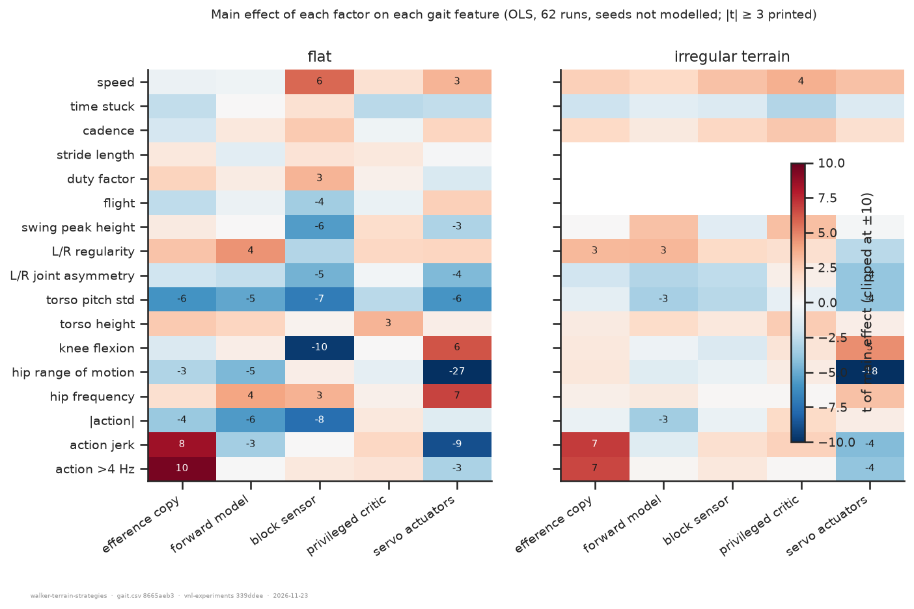

Main effect of each factor on each standardised feature. Duty, flight and stride are
blanked on the terrain panel: a foot resting on a block edge with its origin past the
edge reads as airborne there.

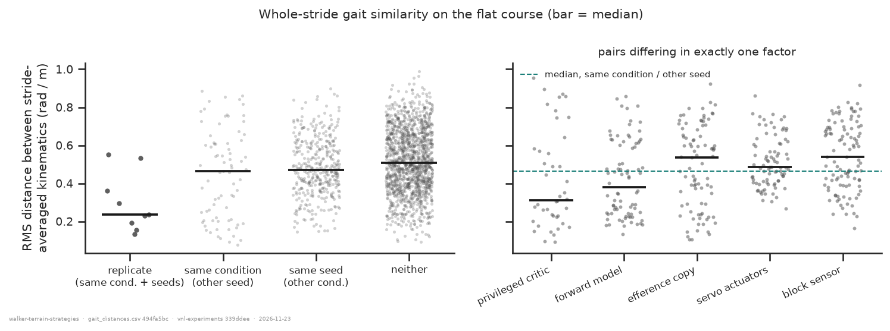

**Beyond these features, the stride is idiosyncratic.**

- Two seeds of the same condition differ by a median 0.47 (RMS over stride-averaged
  angles and foot heights).
- Pairs differing in one factor differ by 0.47; pairs differing in all five by 0.59.
- Exact replicates (same condition and seeds, GPU nondeterminism only) differ by 0.24.
  Sharing the seed helps only when nothing else differs: with one factor changed,
  same-seed pairs are as far apart as different-seed pairs (0.475 vs 0.474).

So each factor moves a few specific features while the rest of the gait is set by the
particular training run. That fits the smooth reward picture: no factor switches the
walker onto a different strategy, except servo, which changes the actuator itself.

## 2. What the policy listens to

`attribution.py` takes the Jacobian of the action mean with respect to everything the
actor pathway is given, at the states it visits. For FM runs the Jacobian runs through
predictor and decoder. Each input's attribution is |∂a/∂x| × std(x), and the figure
shows each input group's share of the total.

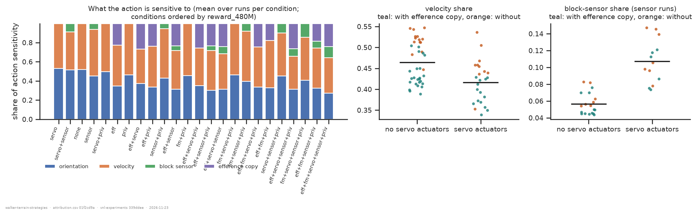

- **Efference copy, when present, takes 18–26 %** of the action's sensitivity, mostly
  at the expense of orientation inputs.
- **Servo nets use half as much velocity feedback** (share −0.06, t = −9) and **twice as
  much block sensor** (0.107 vs 0.057 of the total among sensor runs). This fits the
  physics: a position servo supplies its own stiffness and damping, so velocity feedback
  is less needed, and the gain can go to terrain.
- **Total gain** (sum of |∂a/∂x| × std): efference nets 6.1 vs 4.0 for MLP torque nets;
  FM+efference torque 8.2. Servo totals (2.7–4.5) are in different action units and are
  not comparable with torque totals.

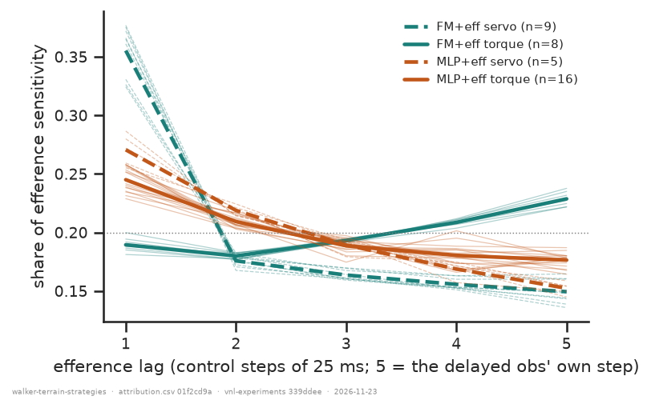

**How each network uses its past actions depends on network type and actuator.** Lag k
is the action emitted k steps ago; lag 5 is the action at the delayed observation's own
time step.

- **FM + torque:** sensitivity rises toward lag 5. A state predictor under torque
  control should do this: an old torque has been integrating into position and velocity
  for longest.
- **FM + servo:** lag 1 dominates (36 %). Also correct physically: under position
  control the joint tracks the most recent target, so that target is the best predictor
  of the current posture.
- **MLP + efference (either actuator):** sensitivity falls with lag. This profile does
  not change with the actuator, as a forward model's would.

The weights strand finds the same thing directly in the predictor's first-layer row
norms (§5): most recent action 1.29 × init with servo vs 0.76 × with torque; oldest
action 0.93 × with torque.

## 3. Is the efference copy an internal oscillator?

With an efference copy the policy is a recurrent system on its own actions. Holding the
sensory input fixed, `attribution.py` linearises the action → queue → action loop at
each visited state and computes its spectral radius ρ.

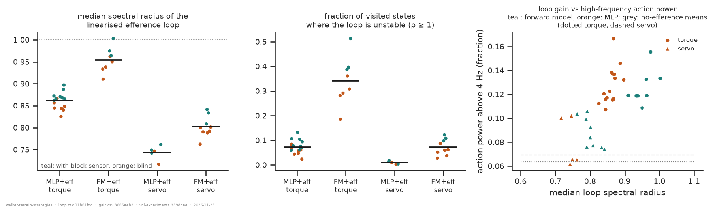

- **The loop is stable but lightly damped:**

  | network | median ρ | states with ρ ≥ 1 |
  |---|---|---|
  | MLP torque | 0.83–0.90 | — |
  | FM torque | 0.91–1.00 | 19–51 % |
  | servo, either network | 0.72–0.84 | — |

- **Its dominant mode is at 5–6 Hz, not the ~1 Hz gait rhythm.** So it is not a gait
  central pattern generator.
- **It matches the extra action power** that efference nets show at 4–7 Hz:
  0.079 vs 0.039–0.044 of action power for torque nets.
- **Across runs within one actuator type, ρ barely predicts that power** (r = 0.19
  torque, −0.14 servo). "The loop rings and that is the jerk" is consistent with the
  group data but not shown run by run.

## 4. Implicit forward model

`probe.py` (notes in `probe_notes.md`) ridge-decodes the current proprioception (24
dims) from each actor-pathway layer, with 3-fold cross-validation by held-out episode. It
scores **delta**: prediction error relative to the variance of obs_t − obs_{t−5}, the
part the delayed input does not already contain. There are three references:

- **linear readout of the input:** delayed obs plus efference queue, as in the
  [rodent analysis](../../rodent/implicit-forward-model/report.md);
- **the same layers with the run's rebuilt init weights:** an untrained-network control,
  new here;
- **a random-features ridge on the input:** what any nonlinear expansion gives.

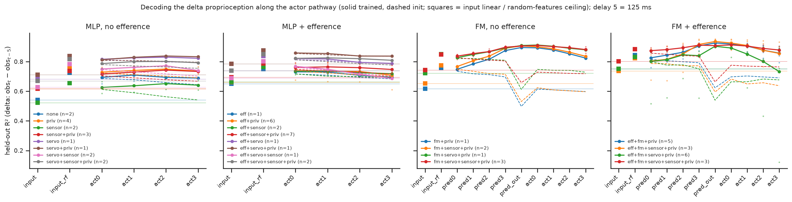

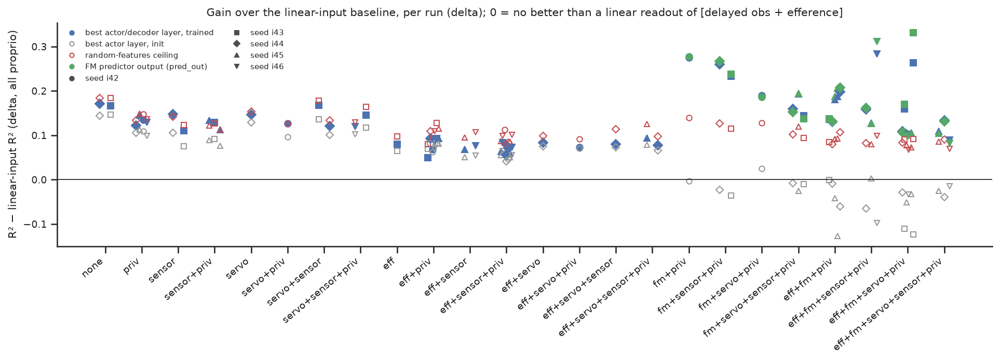

| family (n) | linear input | random features | best actor layer, trained | same, init | FM `pred_out` |
|---|---|---|---|---|---|
| MLP, no efference (17) | 0.61 | 0.76 | 0.75 | 0.72 | – |
| MLP + efference (21) | 0.69 | 0.79 | 0.77 | 0.76 | – |
| FM, no efference (7) | 0.70 | 0.82 | 0.91 | 0.69 | 0.90 |
| FM + efference (17) | 0.76 | 0.84 | 0.91 | 0.71 | 0.91 |

Held-out delta R² across the 24 proprio dims, family means.

- **DelayedMLP: no implicit forward model.**
  - Every MLP layer beats the linear-input baseline by 0.08–0.14. That margin alone
    would look like a forward model.
  - But the *untrained* network beats it almost as much: trained minus init is only
    +0.01 to +0.03 per run.
  - No layer exceeds the random-features ceiling.
  - The apparent gain is a generic nonlinear re-expansion of the input, not a learned
    state estimate. This confirms the rodent conclusion with a stronger control.
- **Efference copy carries state information but builds no model.** It raises the
  *linear* baseline (0.61 → 0.69): recent actions are informative about the current
  state. Yet trained-minus-init is smaller with efference (+0.012) than without
  (+0.029).
- **The explicit FM does build one.** `pred_out` reaches 0.90–0.91, well above both the
  random-features ceiling and init. The decoder's first layer keeps it, and it fades
  toward the output (0.83–0.88 at `act3`). Without an efference copy the FM is almost as
  good, so most of its gain is a better nonlinear extrapolation of the delayed state,
  not action integration.
- **Contacts:**
  - Every family decodes less well on the block courses than on flat ground, the MLPs
    much more so (−0.10 to −0.16, against −0.04 to −0.08 for FM).
  - Frames within 0.5 m of a block are barely worse than other frames (FM 0.88–0.89 vs
    0.90–0.91), so the loss is not concentrated at the block edge.
  - Servo dynamics are easier to predict linearly: the delta baseline is about 0.74 vs
    0.66 for torque.

Caveats: this is linear decodability only, and the init control reuses the trained
run's observation normaliser and was not run in closed loop.

## 5. Weights: interpretable differences and inferring the factors

`weights.py` (notes in `weights_notes.md`) works on ΔW = W − W₀, using the rebuilt
initialisations.

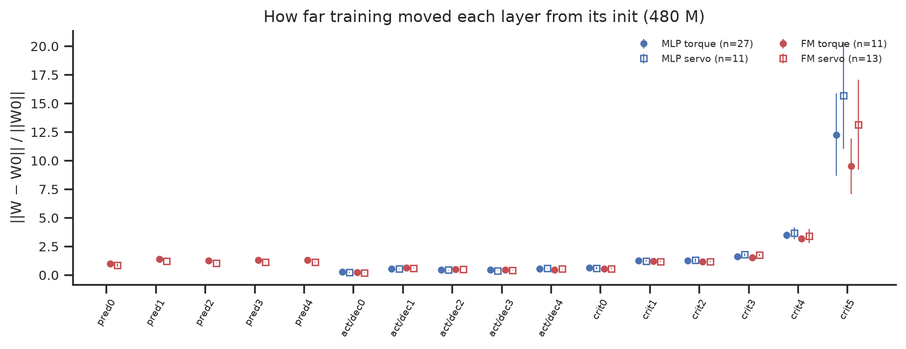

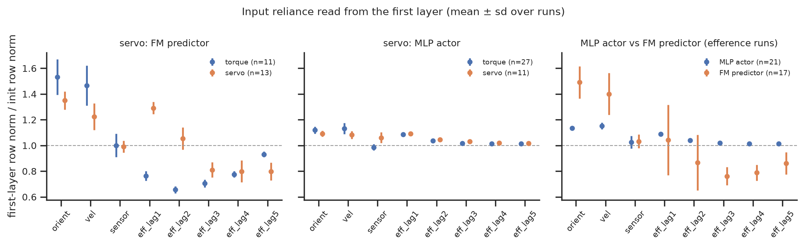

**Interpretable differences:**

- **How far each part moved:**
  - The FM predictor, trained by its own prediction loss, moves 0.9–1.4 × its init
    norm.
  - The policy layers move only 0.2–0.64 ×.
  - The critic moves most: 1.2 × at layer 1, rising to 9–16 × at its output.
- **The MLP actor barely re-weights its efference inputs** (1.01–1.09 × init, highest
  for the most recent action).
- **The FM predictor re-weights strongly:**
  - Observation rows grow to 1.2–1.5 ×.
  - Most efference rows shrink below init, in the actuator-dependent pattern of §2.
  - With servo it also uses velocities less.
- **Block-sensor rows stay at about 1.0 × init everywhere**, although the Jacobian shows
  5–14 % of the action's sensitivity coming from the sensor. Its use is spread through
  the network, not visible in first-layer weight size.
- **Servo** moves the hidden actor layers less and the output head more, with the
  head's change more concentrated in one direction. Learned exploration noise (the
  head's std biases) does not differ between conditions.

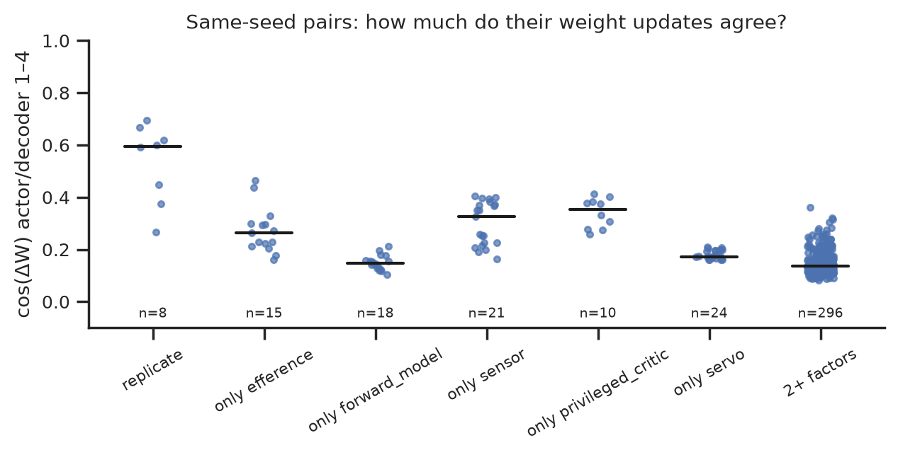

**How differently same-seed runs solve the task.** Cosine of the actor's ΔW within a
seed (hidden units are aligned there):

| pair differs in | median cosine |
|---|---|
| nothing (exact replicates; GPU nondeterminism only) | 0.59 |
| privileged critic only | 0.35 |
| block sensor only | 0.33 |
| efference only | 0.26 |
| servo only | 0.17 |
| forward model only | 0.15 |
| two or more factors | 0.14 |

The forward model and servo change *how* the policy is solved the most. The privileged
critic changes it least. Even nondeterminism alone takes identical runs only to 0.6.

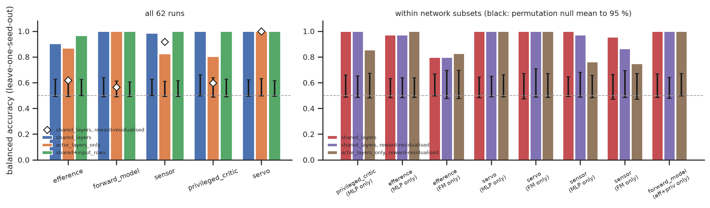

**Inferring the factors.** Logistic regression on permutation-invariant features of the
layers whose shapes are identical in all 62 runs, so nothing is given away by shape.
Leave-one-seed-out cross-validation, 300-permutation null.

| factor | all runs | all runs, reward regressed out | within MLP or FM, actor only, reward regressed out |
|---|---|---|---|
| servo | 1.00 | 1.00 | 1.00 / 1.00 |
| forward model | 1.00 | 0.57 | 1.00 (efference + privileged-critic runs) |
| privileged critic | 1.00 | 0.60 | 0.86 (MLP) |
| block sensor | 0.98 | 0.92 | 0.76 (MLP) / 0.75 (FM) |
| efference | 0.90 | 0.62 | 1.00 (MLP) / 0.83 (FM) |

Balanced accuracy.

- **Reward is the confound in the pooled numbers.** The same features predict reward
  with held-out R² 0.85. With reward regressed out, efference, forward model and
  privileged critic fall to near chance across all 62 runs.
- **Within a network type their signatures come back**, so they exist but differ
  between MLP and FM networks.
- **The block sensor is read mostly from the critic**, which sees it directly. The best
  single feature is the spread of the critic's first hidden-layer biases (0.92). From
  the actor alone it is about 0.75.

**The framing in the question: same architecture, similar reward.** Within one
architecture only servo (and, in MLP/no-efference runs, the privileged critic) varies.
The matched-reward test is the 6 same-seed torque/servo pairs:

- `eff+fm+priv` vs `eff+fm+servo+priv`, both about 835;
- `eff+fm+sensor+priv` vs `eff+fm+servo+sensor+priv`, 909 vs 917.

Holding each pair out in turn, the servo run is identified in all 6. Each of these
differences flips the same way in all six pairs (sign test p = 0.03):

- the predictor's most recent action row rises and its velocity rows fall;
- the knee outputs of the head differ;
- actor layer 3 moves less.

So for this pair of conditions, yes: the factor can be read off the weights, and the
reason is mechanistic. For the other factors and a matched pair of the *same*
architecture, there is no such pair in this grid. Across architectures it works only
with the network type known, and only partly once reward is removed.

## Tentative conclusion

The smooth reward picture is not hiding discrete strategies, with one exception:
**servo actuators produce a different gait and a different controller.** Smaller,
quicker, in-range joint excursions instead of limit-to-limit swings; less velocity
feedback and more terrain input; a forward model that leans on the latest command. That
signature is legible in behaviour, in the Jacobians and in the weights, at matched
reward.

The other factors act more like **adjustments to one solution**:

- the sensor makes stepping anticipatory and lower;
- the forward model makes the gait more regular and gives the decoder a better state
  estimate;
- the efference copy raises the policy's gain and adds 5–6 Hz action jitter through a
  lightly damped internal loop;
- the privileged critic changes the policy least of all.

Within each condition, much of the stride and most of the weight update is set by the
individual training run. As in the rodent, **networks without a forward model do not
build one implicitly**, and the untrained-network control shows that even the modest
"better than linear input" decodability is a property of the random architecture rather
than of learning.

## Follow-ups

- **Closed-loop ablations,** which need the GPU stack: zero or shuffle the efference
  queue, or the block sensor, at run time. This would test whether the 5–6 Hz loop
  causes the jitter, and how much reward each input actually carries.
- **Matched-reward pairs for the other factors** (e.g. more seeds of `eff+sensor+priv`
  vs `fm+sensor+priv` at ~800–835). These would make the "infer from weights" question
  answerable beyond servo without regressing out reward.
- **Track strategy across checkpoints** (`weights --steps all`). Check whether the
  bound-vs-walk split of `eff+fm+sensor+priv` and the servo signature appear early or
  late, and whether ΔW cosine between same-seed conditions diverges steadily or in a
  burst.
- **Probe the critic** for the current state and for block geometry. The weights say the
  sensor is read there most clearly.
- **Fit a seed-level model** (seed as a random effect or a block permutation, as in
  `ball-in-cup-first-look`) before quoting any effect here as a finding.

---

*Reproduce* (from this folder, CPU only, ~25 min total; the probe takes ~20):

```bash
PY=../../../../.venv/bin/python; export OMP_NUM_THREADS=8
$PY check_forward.py && $PY gait.py && $PY gait_cycle.py && $PY attribution.py
$PY probe.py && $PY weights.py && $PY plot.py
```
